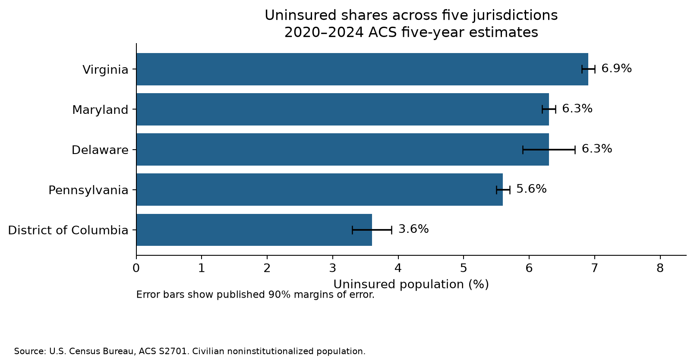

# Bar Chart

**Also known as:** bar graph, column chart, vertical bar chart, horizontal bar chart

## Purpose and Overview

A bar chart displays categorical data with rectangular bars whose length or height corresponds to the value of each data point.

Bar charts can use vertical or horizontal bars and are best used to compare values across one or more discrete categories. When comparing more than one category of data, bars can be grouped together to create a grouped bar chart.

Bar charts make differences in magnitude easier to identify because readers compare the lengths of bars along a common scale.

## When to Use

Use a bar chart when the primary analytical goal is to compare values across discrete categories. Bar charts are particularly useful when readers need to identify differences in magnitude, rankings, or patterns across categories.

Horizontal bar charts can be useful when category labels are long because they provide more space for readable labels.

### Essential

- Bars must always start at the zero origin. The heights or lengths of the bars are proportional to the values they represent. For this reason, bar charts that do not start at zero can mislead the viewer's assessment of differences between values.
- Facilitate the most important analytical comparison by placing bars representing relevant quantities next to each other or in logical groupings.
- If categories that would normally be displayed have been removed, include a statement describing the omission or exclusion.
- Use labels that read from left to right. If category labels are too long along the x-axis, use horizontal bars along the y-axis to improve label readability.
- Use the same width for each bar.

### Avoid

- Do not omit the space between categories; otherwise, the bar chart may appear to be a histogram.
- Do not use three-dimensional (3D) graphics because they can distort the image and its interpretation.

## When to Use an Alternative

Consider another visualization when the number of categories makes a bar chart difficult to read or when the analytical objective is better communicated through another visual representation.

A **lollipop chart** may be useful when comparing many categories because it can reduce visual weight while preserving a common baseline.

A **stacked bar chart** may be appropriate when the objective is to compare both overall category values and subgroup composition.

A **table** may be preferable when readers need exact numerical values rather than primarily visual comparisons.

A **slope diagram** may be more appropriate when the main analytical question concerns changes between two time points across several groups.

## Additional Recommendations

### Recommended

- Use visual components purposefully to promote readability, ease of interpretation, transparency, and reduction of redundancy.
- Ensure that bar charts, including stacked bar charts, have labels sufficient to clearly define the categories represented.
- Sort bars in an analytically meaningful order that supports the main purpose of the chart. If there is no natural analytical ordering, consider sorting bars by value.
- Use consistent scales when creating small multiple charts.
- Ensure that bar thickness is greater than the white space between bars.
- Use additional color only when it supports the analytical purpose of the chart.
- Use one color for all bars unless there is a reason to emphasize a particular bar or category.
- Limit the number of bars when possible. Too many bars can make individual categories difficult to distinguish.
- Consider horizontal bars when additional space is needed for category labels.

### Not Recommended

- Do not add colors that do not communicate additional information or meaningful emphasis.
- Avoid displaying so many categories that individual comparisons become difficult to interpret.

## Choosing Between Alternatives

| Analytical Goal | Alternative Visualization | Why It May Be Preferable |
|---|---|---|
| Compare many category values | Lollipop Chart | Reduces visual weight while retaining a common scale for comparison. |
| Compare category totals and subgroup composition | Stacked Bar Chart | Shows both overall category magnitude and subgroup composition. |
| Present exact numerical values | Table | Allows readers to look up and compare precise values directly. |
| Compare changes between two time points | Slope Diagram | Emphasizes the direction and magnitude of change between two points. |

## Data Requirements and Statistical Considerations

For the Census data example on this page, the bar chart uses the U.S. Census Bureau American Community Survey (ACS) 2020–2024 5-Year Estimates, Subject Table S2701, *Selected Characteristics of Health Insurance Coverage in the United States*. The analytical measure is the percentage of the civilian noninstitutionalized population without health insurance coverage.

The example compares five jurisdictions: Delaware, the District of Columbia, Maryland, Pennsylvania, and Virginia. Geography is treated as the categorical variable, and the uninsured percentage is the quantitative measure represented by bar length. Percentages are displayed in percentage units, and the bars begin at zero so that their lengths remain proportional to the values being compared.

ACS five-year estimates represent data collected across the full five-year period and should not be interpreted as estimates for only the final year. The published margins of error use a 90% confidence level and should be retained when evaluating statistical uncertainty. Differences between displayed estimates should not automatically be interpreted as statistically significant.

The underlying data should also be reviewed for missing or suppressed values, annotations, consistent population definitions, and compatible denominators before visualization. Missing or unavailable Census values should not be treated as zero. When comparing or ranking jurisdictions, rounding and sampling uncertainty should also be considered. For example, Delaware and Maryland both have a displayed uninsured estimate of 6.3% for 2020–2024 and should not be ranked as different based only on the rounded estimates.

**Example data specification**

| Element | Specification |
|---|---|
| Census product | American Community Survey (ACS) 5-Year Estimates |
| Table | S2701 – Selected Characteristics of Health Insurance Coverage in the United States |
| Reference period | 2020–2024 |
| Universe | Civilian noninstitutionalized population |
| Measure | Population without health insurance coverage (%) |
| Geography | Delaware, District of Columbia, Maryland, Pennsylvania, and Virginia |
| Unit | Percent |
| Uncertainty | Published 90% margin of error |

## Visualization-Specific Considerations

Bar length is the primary visual encoding in a bar chart and should remain proportional to the value represented. Because viewers compare bar lengths, the zero baseline is essential for avoiding exaggerated visual differences.

The order of categories should support the analytical purpose of the visualization. Categories with a natural or ordinal sequence should retain that sequence. Otherwise, an analytical ordering, such as ranking by value, may make comparisons easier.

Relevant component guidance should also be consulted for axes, color, grids, legends, sources, titles, and typography.

## Accessibility

- **Alt text:** Describe the chart's main comparison or takeaway rather than simply identifying it as a "bar chart."
- **Data table alternative:** Provide the underlying data in an accessible table or downloadable format when appropriate.
- **Do not rely on color alone:** Use labels, patterns, direct annotation, or other visual cues when color is used to distinguish categories.
- See [508 Compliance](508.html) and [Color](color.html) for general accessibility guidance.

## Census Data Example

### Analytical Question

How does the percentage of the civilian noninstitutionalized population without health insurance coverage compare across Delaware, the District of Columbia, Maryland, Pennsylvania, and Virginia?

A horizontal bar chart is appropriate for this question because the primary analytical task is to compare one quantitative measure across a small number of discrete geographic categories. Bar length provides a common baseline for comparison, while the horizontal orientation provides sufficient space for readable jurisdiction labels.

### Example Results

| Geography | Uninsured population (%) | 90% margin of error |
|---|---:|---:|
| District of Columbia | 3.6% | ±0.3 percentage points |
| Pennsylvania | 5.6% | ±0.1 percentage points |
| Delaware | 6.3% | ±0.4 percentage points |
| Maryland | 6.3% | ±0.1 percentage points |
| Virginia | 6.9% | ±0.1 percentage points |

**Source:** U.S. Census Bureau, American Community Survey, 2020–2024 ACS 5-Year Estimates, Subject Table S2701, *Selected Characteristics of Health Insurance Coverage in the United States*.

The displayed estimates range from 3.6% in the District of Columbia to 6.9% in Virginia. Delaware and Maryland both display an uninsured estimate of 6.3%. Because ACS estimates are subject to sampling uncertainty and these values are rounded for display, the chart should not imply that jurisdictions with the same displayed estimate differ from one another.

The values are descriptive survey estimates. The example does not test statistical significance or establish causal explanations for differences among jurisdictions. The 2020–2024 ACS five-year estimates represent the full five-year period and should not be interpreted as measurements for 2024 alone.

### Example Visualization

The final reproducible Python example will generate the following visualization:

**Text description:** The horizontal bar chart compares uninsured population percentages for five jurisdictions. The District of Columbia has the lowest displayed estimate at 3.6%, followed by Pennsylvania at 5.6%. Delaware and Maryland both display 6.3%, and Virginia has the highest displayed estimate at 6.9%. These descriptive estimates are subject to ACS sampling uncertainty and should not by themselves be interpreted as statistically significant differences.

## Developer Implementation

### Python

The Python implementation for this example uses `pandas` for data preparation and `matplotlib` for visualization. The implementation will reproduce the horizontal bar chart using the validated ACS S2701 estimates from the project EDA workflow.

The implementation should:

- preserve the Census source, universe, reference period, measure, and geographic definitions;
- retain the published margins of error for interpretation;
- use geography as the categorical variable and uninsured percentage as the quantitative variable;
- begin the quantitative scale at zero;
- order the jurisdictions by the displayed estimate to support comparison;
- use direct percentage labels so that values are not communicated through bar length alone;
- use a horizontal orientation to support readable geographic labels; and
- generate the final visualization as `assets/BarChart1.png`.

The underlying data table should remain available as an accessible alternative to the visualization.

> **Statistical note:** The visualization supports descriptive comparison of published ACS estimates. The chart alone should not be used to determine whether differences between jurisdictions are statistically significant.

### R

> **Planned Phase 2 enhancement:** Add a corresponding R implementation after the Python example has been validated. The R version should use the same Census source, analytical measure, geographies, ordering, labels, and interpretation boundaries so that the Python and R implementations can be evaluated for consistency and reproducibility.
## Common Errors and Misinterpretations

| Issue | Why It Matters | Recommended Correction |
|---|---|---|
| Truncated baseline | Can exaggerate apparent differences between categories. | Start bar charts at zero. |
| No spacing between categories | Can make the visualization appear to be a histogram and blur the distinction between discrete categories. | Maintain visible spacing between bars representing separate categories. |
| 3D effects | Can distort perceived bar dimensions and make accurate comparisons more difficult. | Use a two-dimensional presentation. |
| Excessive categories | Makes individual bars and labels difficult to compare. | Reduce categories or consider a lollipop chart or table. |
| Unnecessary color | Adds visual noise without improving interpretation. | Use color selectively to communicate meaning or emphasis. |
| Inconsistent scales across comparable charts | Can create misleading visual comparisons. | Use consistent scales when charts are intended to be compared. |

## Publication Quality Checklist

- [ ] The bar chart is appropriate for the analytical question.
- [ ] Bars begin at zero.
- [ ] Categories are ordered in an analytically meaningful way.
- [ ] Labels clearly identify categories and units.
- [ ] Bar widths and spacing are consistent.
- [ ] Omitted categories are documented.
- [ ] Color is used purposefully and is not the only means of communicating information.
- [ ] The visualization does not use 3D effects.
- [ ] Relevant accessibility guidance has been followed.
- [ ] Data source, geography, reference period, and units are documented where applicable.
- [ ] Relevant limitations, missing values, and statistical uncertainty are addressed where applicable.
- [ ] Related component guidance has been reviewed.
- [ ] The Census dataset, table, universe, reference period, geography, and measure are documented.
- [ ] Published margins of error and interpretation limitations are addressed where applicable.
- [ ] An accessible data-table alternative and meaningful text description accompany the example visualization.
      
## Examples

Existing Census Bureau bar chart examples should be retained here as they are reviewed and incorporated into the standardized page structure.

The current guidance references figures 7–13 on pages 24–28. These examples should be reviewed during the next content-validation step before being modified or replaced.

## Related Pages

- [Stacked Bar Chart](stackedbarchart.html): use when comparisons also involve subgroup composition.
- [Lollipop Charts](lollipopcharts.html): consider when comparing many categories.
- [Tables](table.html): use when precise numerical values are the primary requirement.
- [Slope Diagram](slopediagram.html): use for comparisons between two time points.
- [Axes](axes.html): guidance for axis labels, scales, and tick marks.
- [Typography](typography.html): guidance for readable labels and text.
- [Comparing Data and Values](comparison.html): guidance for designing accurate comparisons.
- [508 Compliance](508.html): general accessibility requirements.
- [Color](color.html): guidance for appropriate and accessible use of color.
