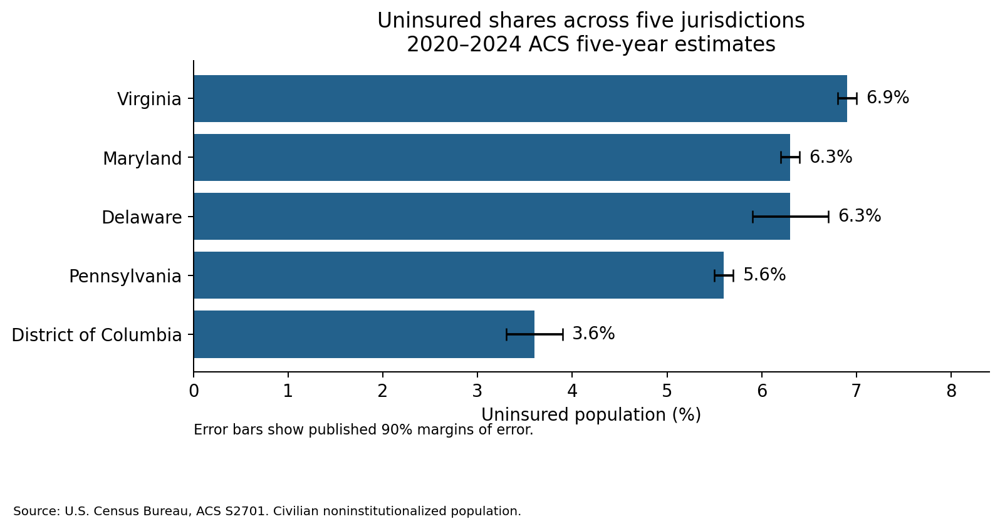

# Bar Chart

**Also known as:** bar graph, column chart, vertical bar chart, horizontal bar chart

## Purpose and Overview

A bar chart displays categorical data with rectangular bars whose length or height corresponds to the value represented.

Bar charts can use vertical or horizontal bars and are best suited for comparing values across one or more discrete categories. When multiple series are compared within the same categories, bars may be grouped together to create a grouped bar chart.

Bar charts support accurate magnitude comparisons because readers compare bar lengths along a common quantitative scale.

## When to Use

Use a bar chart when the primary analytical goal is to compare values across discrete categories. Bar charts are particularly useful when readers need to identify differences in magnitude, rankings, or patterns across categories.

Horizontal bar charts are useful when category labels are long because they provide additional space for readable labels.

Consider another visualization when the number of categories makes a bar chart difficult to read or when the analytical objective is better communicated through another visual form.

A **lollipop chart** may be useful when comparing many categories because it can reduce visual weight while preserving a common quantitative scale.

A **stacked bar chart** may be appropriate when the objective is to compare category totals together with subgroup composition.

A **table** may be preferable when readers primarily need exact numerical values.

A **slope diagram** may be more appropriate when the analytical question focuses on changes between two time points across several groups.

## Data Requirements and Statistical Considerations

For the Census data example on this page, the bar chart uses the U.S. Census Bureau American Community Survey (ACS) 2020–2024 5-Year Estimates, Subject Table S2701, *Selected Characteristics of Health Insurance Coverage in the United States*. The analytical measure is the percentage of the civilian noninstitutionalized population without health insurance coverage.

The example compares five jurisdictions: Delaware, the District of Columbia, Maryland, Pennsylvania, and Virginia. Geography is the categorical variable, and the uninsured percentage is the quantitative measure represented by bar length. Percentages are displayed in percentage units, and the quantitative scale begins at zero so that bar lengths remain proportional to the values being compared.

ACS five-year estimates represent data collected across the full five-year period and should not be interpreted as estimates for only the final year. The margins of error used in this example are the **published Census 90% margins of error**; they are not calculated by the visualization code.

Survey estimates should be interpreted with their statistical uncertainty. Differences between displayed estimates should not automatically be interpreted as statistically significant. An appropriate statistical test is required when a significance determination is needed.

The underlying data should also be reviewed for missing or suppressed values, annotations, consistent population definitions, compatible denominators, and other relevant Census documentation before visualization. Missing or unavailable Census values should not be treated as zero.

Rounding should also be considered when comparing or ranking jurisdictions. For example, Delaware and Maryland both have a displayed uninsured estimate of 6.3% for 2020–2024 and should not be ranked as different based only on the rounded displayed estimates.

### Example Data Specification

| Element | Specification |
|---|---|
| Census product | American Community Survey (ACS) 5-Year Estimates |
| Table | S2701 – Selected Characteristics of Health Insurance Coverage in the United States |
| Reference period | 2020–2024 |
| Universe | Civilian noninstitutionalized population |
| Measure | Population without health insurance coverage (%) |
| Geography | Delaware, District of Columbia, Maryland, Pennsylvania, and Virginia |
| Unit | Percent |
| Uncertainty | Census-published 90% margin of error |

## Guidance

In addition to the guidance below, follow the repository's related guidance for axes, color, grids, sources, titles, typography, accessibility, and comparing data and values where applicable.

### Essential

- Start bars at zero. Bar length or height encodes magnitude, so a truncated baseline can exaggerate perceived differences.
- Place related quantities next to one another or in logical groups when doing so supports the primary analytical comparison.
- If categories that would normally be displayed have been omitted, clearly disclose the omission or exclusion.
- Use labels that read from left to right. When category labels are long, consider horizontal bars to improve readability.
- Use consistent bar widths.
- Use an analytically meaningful category order.
- Clearly identify the measure and units.
- When ACS estimates are displayed, consider the published margins of error and other relevant uncertainty before interpreting small differences.
- Preserve missing, suppressed, or unavailable values rather than converting them to zero.

### Avoid

- Do not eliminate the visual separation between discrete categories; otherwise, the bar chart may resemble a histogram.
- Do not use three-dimensional graphics because they can distort perceived bar dimensions and make comparisons more difficult.
- Do not truncate the quantitative baseline.
- Do not use unnecessary colors that do not communicate additional information.
- Do not imply statistical significance from small differences between survey estimates without appropriate statistical analysis.
- Do not describe an ACS five-year estimate as representing only the final year of the five-year period.

## Additional Recommendations

### Recommended

- Use visual components purposefully to support readability, interpretation, transparency, and reduction of unnecessary visual elements.
- Provide labels sufficient to clearly identify the categories represented.
- Sort bars in an analytically meaningful order that supports the chart's primary purpose. If there is no natural analytical order, sorting by value may improve comparison.
- Use consistent scales when presenting comparable small-multiple charts.
- Maintain sufficient bar thickness and spacing for readability.
- Use additional color only when it supports the analytical purpose of the chart.
- Consider using one color for all bars unless meaningful emphasis or categorical distinction is required.
- Limit the number of bars when possible; too many categories can make individual comparisons difficult.
- Consider horizontal bars when additional space is needed for category labels.
- Provide a meaningful text description or accessible data alternative.
- Document the data source, reference period, geography, universe, measure, and units.

### Not Recommended

- Avoid colors that do not communicate meaningful information or emphasis.
- Avoid displaying so many categories that individual comparisons become difficult to interpret.
- Avoid category ordering that obscures the primary analytical comparison.
- Avoid relying only on color to communicate differences.
- Avoid presenting rounded survey estimates as exact values without considering relevant uncertainty.

## Examples and Discussion

### Analytical Question

How does the percentage of the civilian noninstitutionalized population without health insurance coverage compare across Delaware, the District of Columbia, Maryland, Pennsylvania, and Virginia?

A horizontal bar chart is appropriate because the primary analytical task is to compare one quantitative measure across a small number of discrete geographic categories.

Bar length provides a common baseline for magnitude comparison, while the horizontal orientation provides sufficient space for readable jurisdiction labels.

### Example Results

| Geography | Uninsured population (%) | Published 90% margin of error |
|---|---:|---:|
| District of Columbia | 3.6% | ±0.3 percentage points |
| Pennsylvania | 5.6% | ±0.1 percentage points |
| Delaware | 6.3% | ±0.4 percentage points |
| Maryland | 6.3% | ±0.1 percentage points |
| Virginia | 6.9% | ±0.1 percentage points |

**Source:** U.S. Census Bureau, American Community Survey, 2020–2024 ACS 5-Year Estimates, Subject Table S2701, *Selected Characteristics of Health Insurance Coverage in the United States*.

The displayed estimates range from 3.6% in the District of Columbia to 6.9% in Virginia. Delaware and Maryland both display an uninsured estimate of 6.3%.

The published margins of error communicate sampling uncertainty associated with the estimates. They are supplied by the Census Bureau and are not calculated by the Python or R visualization implementations.

These values are descriptive survey estimates. The chart does not test statistical significance or establish causal explanations for differences among jurisdictions. Overlap or non-overlap of the displayed margins of error alone should not be treated as a statistical significance test.

The 2020–2024 ACS five-year estimates represent the full five-year period and should not be interpreted as measurements for 2024 alone.

### Example Visualization

The validated reproducible Python implementation generates the primary documented visualization:



**Text description:** The horizontal bar chart compares uninsured population percentages for five jurisdictions. The District of Columbia has the lowest displayed estimate at 3.6%, followed by Pennsylvania at 5.6%. Delaware and Maryland both display 6.3%, and Virginia has the highest displayed estimate at 6.9%. Census-published 90% margins of error are shown to communicate sampling uncertainty. These descriptive estimates should not by themselves be interpreted as statistically significant differences.

## Developer Implementation

The reproducible Bar Chart example uses a versioned ACS S2701 source-data snapshot to create a horizontal bar chart comparing uninsured population percentages across five selected jurisdictions.

Implementations are provided in both Python and R. Both versions use the same Census source data, geographic scope, category ordering, zero baseline, Census-published 90% margins of error, and analytical specifications.

The Python-generated image is used as the primary documented visualization on this page. The corresponding R output supports cross-language reproducibility and validation.

### Data Preparation

The example uses the following ACS S2701 fields and analytical specifications:

- **Geographic identifier:** State-level `GEO_ID` records for Delaware, District of Columbia, Maryland, Pennsylvania, and Virginia.
- **Estimate:** `S2701_C05_001E`, percentage of the civilian noninstitutionalized population without health insurance coverage.
- **Margin of error:** `S2701_C05_001M`, Census-published 90% margin of error for the uninsured percentage.
- **Reference period:** 2020–2024 ACS 5-Year Estimates.
- **Universe:** Civilian noninstitutionalized population.
- **Unit:** Percent.
- **Geographic scope:** Five selected jurisdictions.

The implementations validate the required Census fields and expected jurisdictions before creating the visualization.

Estimate and margin-of-error fields are converted to numeric values and validated before use. Missing, suppressed, invalid, or unavailable Census values should remain missing and should not be converted to zero.

### Implementation Details

| Element | Specification |
|---|---|
| Languages | Python and R |
| Python libraries | pandas and matplotlib |
| R graphics | Base R graphics |
| Data source | U.S. Census Bureau, 2020–2024 ACS 5-Year Estimates, Subject Table S2701 |
| Geographic level | Selected state-level jurisdictions |
| Measure | Percentage without health insurance coverage |
| Uncertainty | Census-published 90% margins of error |
| Python source file | [`BarChart.py`](code/BarChart.py) |
| R source file | [`BarChart.R`](code/BarChart.R) |
| Versioned source data | [`ACSST5Y2024.S2701-Data.csv`](data/ACSST5Y2024.S2701-Data.csv) |
| Primary visualization output | [`BarChart1.png`](assets/BarChart1.png) |
| R validation output | [`BarChart1_R.png`](assets/BarChart1_R.png) |

### Python Implementation

The Python implementation uses `pandas` for data preparation and `matplotlib` for visualization.

**Reproducible Python code:** [View `BarChart.py`](code/BarChart.py)

The Python implementation:

- reads the versioned ACS S2701 source file from `visualization_type/data/`;
- validates the required Census fields and selected jurisdictions;
- uses `S2701_C05_001E` for the uninsured population percentage;
- uses `S2701_C05_001M` for the Census-published 90% margin of error;
- converts estimate and margin-of-error fields to numeric values;
- treats geography as the categorical variable and uninsured percentage as the quantitative variable;
- begins the quantitative scale at zero;
- orders jurisdictions by displayed estimate to support comparison;
- uses direct percentage labels;
- displays the published 90% margins of error;
- uses a horizontal orientation to support readable geographic labels; and
- generates `assets/BarChart1.png`.

Run the Python implementation from the repository root with:

```bash
python visualization_type/code/BarChart.py
```

### R Implementation

The R implementation reproduces the same Census data selection, analytical measure, geographic scope, ordering, zero baseline, direct labels, and published 90% margins of error used by the Python implementation.

**Reproducible R code:** [View `BarChart.R`](code/BarChart.R)

The R implementation reads the same versioned ACS S2701 source snapshot and generates a corresponding visualization using the same analytical specifications.

Run the R implementation from the repository root with:

```bash
Rscript visualization_type/code/BarChart.R
```

Minor differences in typography, spacing, label placement, or other graphical rendering details may occur because Python and R use different graphics systems. These differences do not change the underlying Census data, calculations, or analytical interpretation.

### Output Files

| File | Purpose |
|---|---|
| `assets/BarChart1.png` | Python-generated primary documented bar chart |
| `assets/BarChart1_R.png` | R-generated corresponding output used for cross-language validation |
| `data/ACSST5Y2024.S2701-Data.csv` | Versioned ACS S2701 source-data snapshot used by both implementations |

Both Python and R implementations were executed against the same versioned ACS S2701 source data.

Cross-language validation confirmed consistent Census estimates, published 90% margins of error, geographic scope, category ordering, zero-baseline treatment, and analytical interpretation.

Repository-integration testing also confirmed that both implementations can read the versioned source data and generate their expected outputs from the Phase 2 sponsor-repository structure.

> **Statistical note:** This visualization supports descriptive comparison of published ACS estimates. The chart alone should not be used to determine whether differences between jurisdictions are statistically significant.

## Reproducibility and Adaptation

The example can be adapted to other ACS measures, geographies, and reporting periods. When adapting the example:

- **Verify Census variable definitions.** Confirm that the selected estimate and margin-of-error variables represent the intended measure.
- **Preserve the reference period.** Clearly identify the complete ACS five-year period rather than describing the estimate as representing only its final year.
- **Retain a zero baseline.** Bar length represents magnitude, so the quantitative scale should begin at zero.
- **Preserve uncertainty information when relevant.** When displaying ACS survey estimates, retain published margins of error or otherwise communicate statistical uncertainty appropriately.
- **Handle missing values explicitly.** Missing, suppressed, invalid, or unavailable values should not be converted to zero.
- **Use meaningful ordering.** Sort categories according to the analytical purpose and use deterministic handling of ties.
- **Preserve population definitions.** Confirm that the universe and denominator remain appropriate when substituting another Census measure.
- **Check accessibility and legibility.** Verify labels, typography, contrast, text descriptions, and accessible data alternatives at the intended display size.
- **Document adaptations.** Record changes to the dataset, table, geography, measure, reference period, or visualization specification.
- **Revalidate both implementations.** Rerun the Python and R versions after changing the source data or analytical logic.

### Maintenance Notes

When maintaining this example:

- preserve the Census table, universe, measure, geography, and reference-period definitions unless the documentation is intentionally revised;
- verify ACS variable definitions before substituting a newer source-data snapshot;
- retain published margins of error when uncertainty is relevant to interpretation;
- do not convert missing, suppressed, invalid, or unavailable Census values to zero;
- rerun both Python and R implementations after source-data or code changes;
- confirm that generated outputs reflect the intended data and analytical specifications; and
- verify that documentation links, source notes, text descriptions, and accessibility information remain current.

### Validation Before Publication

Before publishing this example or an adapted version:

- verify the Census source file and ACS variable definitions;
- confirm that expected geographic records are present and unique;
- check for missing, invalid, suppressed, or duplicate records;
- verify that the quantitative scale begins at zero;
- confirm that category ordering supports the intended comparison;
- verify that published margins of error are correctly represented when included;
- confirm that labels, source information, and reference-period wording are accurate;
- review relevant ACS uncertainty information before interpreting differences between jurisdictions;
- inspect the generated visualization at the intended display size;
- confirm that a meaningful text description or accessible data alternative is available; and
- rerun both Python and R implementations to confirm reproducibility after substantive changes.

The goal is to preserve the analytical meaning of the Census data while allowing developers to adapt the example to other appropriate measures, geographies, and reporting periods.

## Common Errors and Misinterpretations

| Issue | Why It Matters | Recommended Correction |
|---|---|---|
| Truncated baseline | Can exaggerate apparent differences between categories. | Start bar charts at zero. |
| No spacing between categories | Can make the visualization resemble a histogram and blur the distinction between discrete categories. | Maintain visible spacing between bars representing separate categories. |
| 3D effects | Can distort perceived bar dimensions and make accurate comparisons more difficult. | Use a two-dimensional presentation. |
| Excessive categories | Makes individual bars and labels difficult to compare. | Reduce categories or consider a lollipop chart or table. |
| Unnecessary color | Adds visual noise without improving interpretation. | Use color selectively to communicate meaning or emphasis. |
| Inconsistent scales across comparable charts | Can create misleading visual comparisons. | Use consistent scales when charts are intended to be compared. |
| Treating missing values as zero | Can create false values and misleading comparisons. | Preserve missing, suppressed, or unavailable values and document their treatment. |
| Ignoring margins of error | Small differences between ACS estimates may be overinterpreted. | Review published uncertainty and applicable statistical guidance before interpreting differences. |
| Treating a five-year estimate as a single-year value | Misstates the ACS reference period. | Describe 2020–2024 estimates as representing the full five-year period. |
| Treating error-bar overlap as a significance test | Visual overlap alone does not establish statistical significance. | Use an appropriate statistical test when significance is the analytical question. |

## Publication Quality Checklist

- [ ] The bar chart is appropriate for the analytical question.
- [ ] Bars begin at zero.
- [ ] Categories are ordered in an analytically meaningful way.
- [ ] Labels clearly identify categories and units.
- [ ] Bar widths and spacing are consistent.
- [ ] Omitted categories are documented where applicable.
- [ ] Color is used purposefully and is not the only means of communicating information.
- [ ] The visualization does not use 3D effects.
- [ ] Relevant accessibility guidance has been followed.
- [ ] The Census dataset, table, universe, geography, reference period, measure, and units are documented.
- [ ] Missing, suppressed, or unavailable values are handled appropriately.
- [ ] Published margins of error and interpretation limitations are addressed where applicable.
- [ ] An accessible data alternative or meaningful text description accompanies the example.
- [ ] The versioned source-data snapshot is documented.
- [ ] Python and R implementations have been executed and verified.
- [ ] Cross-language results have been reviewed for analytical consistency.
- [ ] Generated output has been inspected before publication.
- [ ] Reproducibility and adaptation instructions are current.
- [ ] Related component guidance has been reviewed.

## Related Pages

- [Stacked Bar Chart](stackedbarchart.html): use when comparisons also involve subgroup composition.
- [Lollipop Charts](lollipopcharts.html): consider when comparing many categories.
- [Tables](table.html): use when precise numerical values are the primary requirement.
- [Slope Diagram](slopediagram.html): use for comparisons between two time points.
- [Axes](axes.html): guidance for axis labels, scales, and tick marks.
- [Typography](typography.html): guidance for readable labels and text.
- [Comparing Data and Values](comparison.html): guidance for designing accurate comparisons.
- [508 Compliance](508.html): general accessibility requirements.
- [Color](color.html): guidance for appropriate and accessible use of color.
