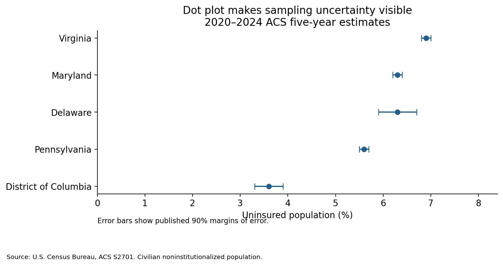

# Dot Plot Chart

**Also known as:** Wilkinson dot plot, Cleveland dot plot, strip plot, dot chart

## Purpose and Overview

A dot plot uses the position of dots to represent observations or quantitative values. Dot plots can support either distribution analysis or categorical comparison depending on the design.

A **Wilkinson dot plot** represents individual observations with dots and can be used to show a distribution while retaining information about individual observations. The arrangement of dots can reveal frequency, clustering, gaps, and unusual values.

A **Cleveland dot plot** compares quantitative values across categories. Instead of encoding magnitude through bar length, as in a bar chart, the position of each dot along a common quantitative scale represents the category value.

Dot plots can provide a compact alternative to other chart types when the analytical objective is to display a distribution or compare categorical values while reducing unnecessary visual weight.

The reproducible Census example on this page uses a **Cleveland-style dot plot** because each dot represents an aggregated ACS estimate for one geographic category rather than an individual observation.

## When to Use

Use a **Wilkinson dot plot** when the analytical objective is to show the distribution of individual observations. It can be useful for relatively small datasets where displaying individual observations provides meaningful information about frequency, clustering, gaps, or unusual values.

Use a **Cleveland dot plot** when the analytical objective is to compare quantitative values across discrete categories. Cleveland dot plots can be particularly useful when multiple categories need to be compared and a bar chart would create unnecessary visual weight.

Consider another visualization when the number of observations creates excessive overlap or when another visual encoding better supports the analytical task.

A **histogram** may be preferable when the dataset contains many observations and the primary objective is to understand the overall shape of a distribution rather than individual observations.

A **bar chart** may be preferable when category magnitude should receive stronger visual emphasis or when the audience is more familiar with bar-based comparisons.

A **lollipop chart** may be useful when comparing categorical values and a stem connecting each value to a baseline improves interpretation.

A **table** may be preferable when readers primarily need exact numerical values.

## Data Requirements and Statistical Considerations

The data requirements depend on the type of dot plot.

For a Wilkinson dot plot, the data should contain individual observations appropriate for displaying a distribution. The number of observations and degree of overlap should be evaluated before selecting this visualization.

For a Cleveland dot plot, the data should contain discrete categories and a quantitative measure that can be represented by dot position along a common scale.

The Census example on this page uses the U.S. Census Bureau American Community Survey (ACS) 2020–2024 5-Year Estimates, Subject Table S2701, *Selected Characteristics of Health Insurance Coverage in the United States*. The analytical measure is the percentage of the civilian noninstitutionalized population without health insurance coverage.

The example compares Delaware, the District of Columbia, Maryland, Pennsylvania, and Virginia. Geography is treated as the categorical variable, and dot position represents the uninsured percentage.

ACS five-year estimates represent data collected across the full five-year period and should not be interpreted as estimates for only the final year.

The margins of error used in this example are the **Census-published 90% margins of error**. They are read directly from the ACS S2701 source data and are not calculated by the Python or R visualization code.

Survey estimates should be interpreted together with their statistical uncertainty. Differences between displayed estimates should not automatically be interpreted as statistically significant.

The overlap or non-overlap of displayed error bars alone is not a statistical significance test. When statistical significance is the analytical question, an appropriate statistical test should be used.

Missing, suppressed, invalid, or unavailable Census values should not be converted to zero. Population definitions, geographic scope, reference periods, units, annotations, and denominators should also be reviewed before comparing Census estimates.

Rounding should be considered when comparing or ranking jurisdictions. Delaware and Maryland, for example, both have a displayed uninsured estimate of 6.3% for 2020–2024 and should not be ranked as different based only on their rounded displayed estimates.

### Example Data Specification

| Element | Specification |
|---|---|
| Dot plot type | Cleveland-style categorical comparison |
| Census product | American Community Survey (ACS) 5-Year Estimates |
| Table | S2701 – Selected Characteristics of Health Insurance Coverage in the United States |
| Reference period | 2020–2024 |
| Universe | Civilian noninstitutionalized population |
| Measure | Population without health insurance coverage (%) |
| Geography | Delaware, District of Columbia, Maryland, Pennsylvania, and Virginia |
| Unit | Percent |
| Uncertainty | Census-published 90% margin of error |

## Guidance

In addition to the guidance below, follow the repository's related guidance for axes, color, grids, sources, titles, typography, accessibility, and comparing data and values where applicable.

### Essential

- Clearly identify what each dot represents.
- Distinguish between a distributional Wilkinson dot plot and a categorical Cleveland dot plot.
- Use a consistent quantitative scale so readers can accurately compare dot positions.
- For categorical comparisons, order categories in a way that supports the analytical objective.
- Ensure dots are large enough to remain visible without obscuring nearby observations, values, or uncertainty information.
- Clearly identify the measure and units.
- Use labels and axis information sufficient for readers to interpret values correctly.
- When ACS estimates are displayed, consider Census-published margins of error and other relevant uncertainty before interpreting differences.
- Preserve missing, suppressed, or unavailable values rather than converting them to zero.
- When individual observations overlap in a distributional dot plot, use a consistent method for representing frequency or density.

### Avoid

- Do not use so many observations that individual dots become indistinguishable or the display becomes excessively cluttered.
- Do not use dot size in a way that unintentionally implies an additional quantitative measure.
- Do not use unnecessary colors that do not communicate meaningful groups or emphasis.
- Do not use inconsistent scales when multiple dot plots are intended to be compared.
- Do not imply statistical significance from error-bar overlap or non-overlap alone.
- Do not describe an ACS five-year estimate as representing only the final year of the five-year period.

## Additional Recommendations

### Recommended

- Sort categories in an analytically meaningful order when using a Cleveland dot plot.
- If there is no natural ordering, consider sorting categories by value to facilitate comparison.
- Use direct labels when they improve interpretation and reduce dependence on a legend.
- Keep visual elements simple so dot position remains the primary quantitative encoding.
- Use color selectively to identify meaningful groups or emphasize analytically important observations.
- Maintain sufficient spacing between category labels, dots, error bars, and annotations.
- Use consistent scales when presenting multiple comparable dot plots.
- Provide a meaningful text description or accessible data alternative.
- Document the data source, reference period, geography, universe, measure, and units.

### Not Recommended

- Avoid decorative elements that compete with the dots or make values harder to compare.
- Avoid using more colors than necessary to communicate the analytical purpose.
- Avoid using a Wilkinson dot plot when the number of observations makes individual dots impossible to interpret.
- Avoid category ordering that obscures the primary analytical comparison.
- Avoid presenting rounded survey estimates as exact values without considering relevant uncertainty.
- Avoid relying only on color to communicate meaningful distinctions.

## Examples and Discussion

### Analytical Question

How does the percentage of the civilian noninstitutionalized population without health insurance coverage compare across Delaware, the District of Columbia, Maryland, Pennsylvania, and Virginia?

A Cleveland-style dot plot is appropriate because the analytical task is to compare one quantitative estimate across a small number of discrete geographic categories.

Each dot represents the uninsured percentage for one jurisdiction. Dot position along the common quantitative scale provides the primary magnitude encoding, while the error bars display the Census-published 90% margins of error.

### Example Results

| Geography | Uninsured population (%) | Published 90% margin of error |
|---|---:|---:|
| District of Columbia | 3.6% | ±0.3 percentage points |
| Pennsylvania | 5.6% | ±0.1 percentage points |
| Delaware | 6.3% | ±0.4 percentage points |
| Maryland | 6.3% | ±0.1 percentage points |
| Virginia | 6.9% | ±0.1 percentage points |

**Source:** U.S. Census Bureau, American Community Survey, 2020–2024 ACS 5-Year Estimates, Subject Table S2701, *Selected Characteristics of Health Insurance Coverage in the United States*.

The displayed estimates range from 3.6% in the District of Columbia to 6.9% in Virginia. Delaware and Maryland both display an uninsured estimate of 6.3%.

The Census-published margins of error communicate sampling uncertainty associated with the estimates. They are supplied by the Census Bureau and are not calculated by the Python or R visualization implementations.

The values are descriptive survey estimates. The visualization does not test statistical significance or establish causal explanations for differences among jurisdictions.

The overlap or non-overlap of the displayed error bars should not, by itself, be interpreted as evidence that two estimates are or are not statistically significantly different.

The 2020–2024 ACS five-year estimates represent the full five-year period and should not be interpreted as measurements for 2024 alone.

### Example Visualization

The validated reproducible Python implementation generates the primary documented visualization:



**Text description:** The Cleveland-style dot plot compares uninsured population percentages for five jurisdictions. The District of Columbia has the lowest displayed estimate at 3.6%, followed by Pennsylvania at 5.6%. Delaware and Maryland both display 6.3%, and Virginia has the highest displayed estimate at 6.9%. Census-published 90% margins of error are displayed as error bars to communicate sampling uncertainty. Error-bar overlap or non-overlap alone should not be interpreted as a statistical significance test.

## Developer Implementation

The reproducible Dot Plot Chart example uses a versioned ACS S2701 source-data snapshot to create a Cleveland-style categorical dot plot comparing uninsured population percentages across five selected jurisdictions.

Implementations are provided in both Python and R. Both versions use the same Census source data, geographic scope, category ordering, quantitative measure, and Census-published 90% margins of error.

The Python-generated image is used as the primary documented visualization on this page. The corresponding R output supports cross-language reproducibility and validation.

### Data Preparation

The example uses the following ACS S2701 fields and analytical specifications:

- **Geographic identifier:** State-level `GEO_ID` records for Delaware, District of Columbia, Maryland, Pennsylvania, and Virginia.
- **Estimate:** `S2701_C05_001E`, percentage of the civilian noninstitutionalized population without health insurance coverage.
- **Margin of error:** `S2701_C05_001M`, Census-published 90% margin of error for the uninsured percentage.
- **Reference period:** 2020–2024 ACS 5-Year Estimates.
- **Universe:** Civilian noninstitutionalized population.
- **Unit:** Percent.
- **Geographic scope:** Five selected jurisdictions.

The implementations validate the required Census fields and expected jurisdictions before creating the visualization.

Estimate and margin-of-error fields are converted to numeric values and validated before use. Missing, suppressed, invalid, or unavailable Census values should remain missing and should not be converted to zero.

### Implementation Details

| Element | Specification |
|---|---|
| Dot plot type | Cleveland-style categorical comparison |
| Languages | Python and R |
| Python libraries | pandas and matplotlib |
| R graphics | Base R graphics |
| Data source | U.S. Census Bureau, 2020–2024 ACS 5-Year Estimates, Subject Table S2701 |
| Geographic level | Selected state-level jurisdictions |
| Measure | Percentage without health insurance coverage |
| Uncertainty | Census-published 90% margins of error |
| Python source file | [`DotPlotChart.py`](code/DotPlotChart.py) |
| R source file | [`DotPlotChart.R`](code/DotPlotChart.R) |
| Versioned source data | [`ACSST5Y2024.S2701-Data.csv`](data/ACSST5Y2024.S2701-Data.csv) |
| Primary visualization output | [`DotPlotChart1.png`](assets/DotPlotChart1.png) |
| R validation output | [`DotPlotChart1_R.png`](assets/DotPlotChart1_R.png) |

### Python Implementation

The Python implementation uses `pandas` for data preparation and `matplotlib` for visualization.

**Reproducible Python code:** [View `DotPlotChart.py`](code/DotPlotChart.py)

The Python implementation:

- reads the versioned ACS S2701 source file from `visualization_type/data/`;
- validates the required Census fields and selected jurisdictions;
- uses `S2701_C05_001E` for the uninsured population percentage;
- uses `S2701_C05_001M` for the Census-published 90% margin of error;
- converts estimate and margin-of-error fields to numeric values;
- treats geography as the categorical variable and uninsured percentage as the quantitative variable;
- orders jurisdictions consistently to support comparison;
- represents each jurisdiction's estimate with a dot;
- displays the Census-published 90% margins of error as error bars;
- uses direct percentage labels where appropriate; and
- generates `assets/DotPlotChart1.png`.

Run the Python implementation from the repository root with:

```bash
python visualization_type/code/DotPlotChart.py
```

### R Implementation

The R implementation reproduces the same Census data selection, analytical measure, geographic scope, ordering, dot-position encoding, and Census-published 90% margins of error used by the Python implementation.

**Reproducible R code:** [View `DotPlotChart.R`](code/DotPlotChart.R)

The R implementation reads the same versioned ACS S2701 source snapshot and generates a corresponding visualization using the same analytical specifications.

Run the R implementation from the repository root with:

```bash
Rscript visualization_type/code/DotPlotChart.R
```

Minor differences in typography, spacing, label placement, or other graphical rendering details may occur because Python and R use different graphics systems. These differences do not change the underlying Census data, calculations, or analytical interpretation.

### Output Files

| File | Purpose |
|---|---|
| `assets/DotPlotChart1.png` | Python-generated primary documented dot plot |
| `assets/DotPlotChart1_R.png` | R-generated corresponding output used for cross-language validation |
| `data/ACSST5Y2024.S2701-Data.csv` | Versioned ACS S2701 source-data snapshot used by both implementations |

Both Python and R implementations were executed against the same versioned ACS S2701 source data.

Cross-language validation confirmed consistent Census estimates, Census-published 90% margins of error, geographic scope, category ordering, and analytical interpretation.

Repository-integration testing also confirmed that both implementations can read the versioned source data and generate their expected outputs from the Phase 2 sponsor-repository structure.

> **Statistical note:** Error bars communicate the published uncertainty associated with the ACS estimates. Their overlap or non-overlap alone should not be interpreted as a statistical significance test.

## Reproducibility and Adaptation

The example can be adapted to other ACS measures, geographies, and reporting periods. When adapting the example:

- **Select the appropriate dot plot type.** Determine whether the analytical task requires a Wilkinson distributional dot plot or a Cleveland categorical dot plot.
- **Verify Census variable definitions.** Confirm that the selected estimate and margin-of-error variables represent the intended measure.
- **Preserve the reference period.** Clearly identify the complete ACS five-year period rather than describing the estimate as representing only its final year.
- **Preserve uncertainty information when relevant.** When displaying ACS survey estimates, retain published margins of error or otherwise communicate statistical uncertainty appropriately.
- **Handle missing values explicitly.** Missing, suppressed, invalid, or unavailable values should not be converted to zero.
- **Use meaningful ordering.** Sort categories according to the analytical purpose and use deterministic handling of ties.
- **Preserve population definitions.** Confirm that the universe and denominator remain appropriate when substituting another Census measure.
- **Check accessibility and legibility.** Verify dot visibility, labels, typography, contrast, text descriptions, and accessible data alternatives at the intended display size.
- **Document adaptations.** Record changes to the dataset, table, geography, measure, reference period, or visualization specification.
- **Revalidate both implementations.** Rerun the Python and R versions after changing the source data or analytical logic.

### Maintenance Notes

When maintaining this example:

- preserve the Census table, universe, measure, geography, and reference-period definitions unless the documentation is intentionally revised;
- verify ACS variable definitions before substituting a newer source-data snapshot;
- retain Census-published margins of error when uncertainty is relevant to interpretation;
- do not convert missing, suppressed, invalid, or unavailable Census values to zero;
- rerun both Python and R implementations after source-data or code changes;
- confirm that generated outputs reflect the intended data and analytical specifications; and
- verify that documentation links, source notes, text descriptions, and accessibility information remain current.

### Validation Before Publication

Before publishing this example or an adapted version:

- confirm that the selected dot plot type matches the analytical task;
- verify the Census source file and ACS variable definitions;
- confirm that expected geographic records are present and unique;
- check for missing, invalid, suppressed, or duplicate records;
- confirm that category ordering supports the intended comparison;
- verify that dot positions accurately represent the intended values;
- verify that Census-published margins of error are correctly represented when included;
- confirm that labels, source information, and reference-period wording are accurate;
- do not infer statistical significance from error-bar overlap or non-overlap alone;
- inspect the generated visualization at the intended display size;
- confirm that a meaningful text description or accessible data alternative is available; and
- rerun both Python and R implementations to confirm reproducibility after substantive changes.

The goal is to preserve the analytical meaning of the Census data while allowing developers to adapt the example to other appropriate measures, geographies, reporting periods, and dot plot applications.

## Common Errors and Misinterpretations

| Issue | Why It Matters | Recommended Correction |
|---|---|---|
| Unclear dot meaning | Readers may not know whether dots represent individual observations or category values. | Clearly identify the dot plot type and explain what each dot represents. |
| Excessive overlap | Individual observations or values become difficult to distinguish. | Adjust the presentation or consider an alternative such as a histogram. |
| Poor category ordering | Makes categorical comparisons unnecessarily difficult. | Use a natural or analytically meaningful order. |
| Inconsistent scales | Can create misleading comparisons across multiple dot plots. | Use consistent scales when plots are intended to be compared. |
| Unnecessary color | Adds visual noise without improving interpretation. | Use color only to communicate meaningful groups or emphasis. |
| Dots too large | Can obscure nearby values or imply magnitude through area. | Use a consistent dot size appropriate to the density of the display. |
| Treating missing values as zero | Can create false values and misleading comparisons. | Preserve missing, suppressed, or unavailable values and document their treatment. |
| Ignoring margins of error | Small differences between ACS estimates may be overinterpreted. | Review Census-published uncertainty before interpreting differences. |
| Treating error-bar overlap as a significance test | Visual overlap or non-overlap alone does not establish statistical significance. | Use an appropriate statistical test when significance is the analytical question. |
| Treating a five-year estimate as a single-year value | Misstates the ACS reference period. | Describe 2020–2024 estimates as representing the full five-year period. |

## Publication Quality Checklist

- [ ] The selected dot plot type is appropriate for the analytical question.
- [ ] It is clear whether dots represent individual observations or categorical values.
- [ ] Axes, scales, units, and categories are clearly identified.
- [ ] Categories are ordered meaningfully when applicable.
- [ ] Dots remain visible and interpretable without excessive overlap.
- [ ] Dot size does not unintentionally encode another quantitative measure.
- [ ] Color is used purposefully and is not the only means of communicating information.
- [ ] Comparable dot plots use consistent scales.
- [ ] The Census dataset, table, universe, geography, reference period, measure, and units are documented.
- [ ] Missing, suppressed, or unavailable values are handled appropriately.
- [ ] Census-published margins of error and interpretation limitations are addressed where applicable.
- [ ] Error-bar overlap or non-overlap is not presented as a statistical significance test.
- [ ] A meaningful text description or accessible data alternative accompanies the example.
- [ ] The versioned source-data snapshot is documented.
- [ ] Python and R implementations have been executed and verified.
- [ ] Cross-language results have been reviewed for analytical consistency.
- [ ] Generated output has been inspected before publication.
- [ ] Reproducibility and adaptation instructions are current.
- [ ] Related component guidance has been reviewed.

## Related Pages

- [Bar Chart](barchart.html): use for categorical comparisons where bar length provides the primary visual encoding.
- [Lollipop Charts](lollipopcharts.html): consider when comparing categorical values with a baseline connection.
- [Tables](table.html): use when precise numerical values are the primary requirement.
- [Axes](axes.html): guidance for axis labels, scales, and tick marks.
- [Comparing Data and Values](comparison.html): guidance for designing accurate comparisons.
- [Typography](typography.html): guidance for readable labels and text.
- [508 Compliance](508.html): general accessibility requirements.
- [Color](color.html): guidance for appropriate and accessible use of color.
