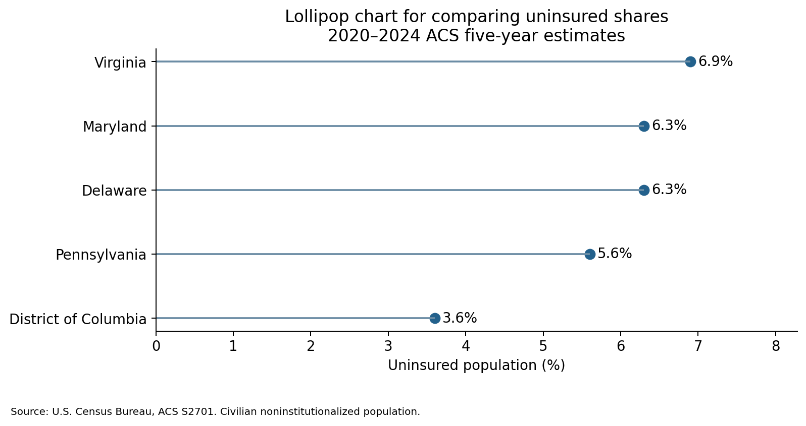

# Lollipop Charts

**Also known as:** Lollipop Graph, Lollipop Chart

## Purpose and Overview

A lollipop chart compares quantitative values across discrete categories using a marker positioned at each value and a line or stem connecting the marker to a common baseline.

Lollipop charts provide an alternative to bar charts when the analytical objective is categorical magnitude comparison but filled bars would create unnecessary visual weight. The marker identifies the represented value, while the stem preserves the visual connection between that value and the baseline.

Lollipop charts can be particularly useful when comparing many categories or relatively large values because the reduced visual weight of the stems can make individual values easier to distinguish.

Marker size requires careful consideration. An excessively large marker can obscure its precise position or unintentionally imply an additional quantitative measure. Unless marker size intentionally represents another variable, markers should use a consistent size.

## When to Use

Use a lollipop chart when the primary analytical objective is to compare quantitative values across discrete categories while reducing the visual weight associated with traditional bars.

Lollipop charts can be particularly useful when:

- many categorical values need to be compared;
- a bar chart would appear visually dense;
- the analytical objective is to emphasize differences or rankings among values; or
- maintaining a visual connection between each value and a common baseline supports interpretation.

A **bar chart** may be preferable when the number of categories is manageable and traditional bars provide a clearer or more familiar magnitude comparison.

A **dot plot** may be preferable when position along a common scale is sufficient and stems connecting values to the baseline are unnecessary.

A **table** may be preferable when readers primarily need exact numerical values.

Consider another visualization when the number of categories, labels, or overlapping values makes individual lollipops difficult to interpret.

## Data Requirements and Statistical Considerations

A lollipop chart requires a categorical variable and a quantitative measure. Each category is represented by a marker positioned according to its value, with a stem connecting the marker to the baseline.

For the Census example on this page, the chart uses the U.S. Census Bureau American Community Survey (ACS) 2020–2024 5-Year Estimates, Subject Table S2701, *Selected Characteristics of Health Insurance Coverage in the United States*. The analytical measure is the percentage of the civilian noninstitutionalized population without health insurance coverage.

The example compares Delaware, the District of Columbia, Maryland, Pennsylvania, and Virginia. Geography is the categorical variable, and the uninsured percentage is the quantitative measure represented by marker position and stem length.

ACS five-year estimates represent data collected across the full five-year period and should not be interpreted as estimates for only the final year.

ACS estimates also have sampling uncertainty. The underlying S2701 source data include Census-published 90% margins of error. The lollipop visualization on this page intentionally does **not** encode those margins of error because its primary purpose is to demonstrate categorical magnitude comparison using the lollipop form.

The absence of error bars does not mean that the estimates have no uncertainty. Published margins of error and applicable Census statistical guidance should be reviewed before interpreting small differences between jurisdictions or making statistical claims.

The visualization is descriptive and should not be used by itself to determine statistical significance. When statistical significance is the analytical question, an appropriate statistical test should be used.

Missing, suppressed, invalid, or unavailable Census values should not be converted to zero. Population definitions, denominators, geographic scope, units, reference periods, and relevant Census annotations should also be reviewed before comparison.

Rounding should be considered when ranking categories. Delaware and Maryland both have a displayed uninsured estimate of 6.3% and should not be ranked as different based only on their rounded displayed estimates.

### Example Data Specification

| Element | Specification |
|---|---|
| Census product | American Community Survey (ACS) 5-Year Estimates |
| Table | S2701 – Selected Characteristics of Health Insurance Coverage in the United States |
| Reference period | 2020–2024 |
| Universe | Civilian noninstitutionalized population |
| Measure | Population without health insurance coverage (%) |
| Geography | Delaware, District of Columbia, Maryland, Pennsylvania, and Virginia |
| Unit | Percent |
| Uncertainty | Census-published 90% margins of error available in source data; not visually encoded in this example |

## Guidance

In addition to the guidance below, follow the repository's related guidance for axes, color, grids, sources, titles, typography, accessibility, and comparing data and values where applicable.

### Essential

- Start lollipop stems at zero because stem length communicates magnitude relative to the baseline.
- Clearly identify the categories, measure, and units.
- Use a consistent marker size unless marker size intentionally represents another variable and that encoding is clearly documented.
- Maintain visible spacing between discrete categories.
- Order categories in a way that supports the primary analytical comparison.
- If categories that would normally be displayed have been omitted, clearly disclose the omission or exclusion.
- Use labels that read naturally. When category labels are long, consider horizontal lollipops to improve readability.
- Preserve missing, suppressed, or unavailable values rather than converting them to zero.
- When displaying ACS estimates, consider the Census-published margins of error and other relevant uncertainty even when uncertainty is not visually encoded.

### Avoid

- Do not truncate the baseline when stem length is being used to communicate magnitude.
- Do not use marker sizes that obscure the represented value or unintentionally imply another quantitative measure.
- Do not eliminate the visual separation between discrete categories.
- Do not use unnecessary colors that do not communicate meaningful information or emphasis.
- Do not use category ordering that makes important comparisons unnecessarily difficult.
- Do not use inconsistent scales when multiple lollipop charts are intended to be compared.
- Do not interpret small differences between ACS estimates as statistically significant without appropriate statistical analysis.
- Do not describe an ACS five-year estimate as representing only the final year of the five-year period.

## Additional Recommendations

### Recommended

- Use visual components purposefully to support readability, interpretation, and reduction of unnecessary visual elements.
- Balance axis labels, data labels, tick marks, color, emphasis, and spacing.
- Ensure category labels clearly identify the values represented.
- Sort categories in an analytically meaningful way that supports the main purpose of the chart.
- If there is no natural or ordinal category order, consider sorting categories by value.
- Use deterministic handling of ties so repeated executions produce consistent ordering.
- Use consistent scales when creating comparable small-multiple charts.
- Use additional color only when it supports the analytical purpose.
- Use direct labels when they improve interpretation.
- Provide a meaningful text description or accessible data alternative.
- Document the data source, reference period, geography, universe, measure, and units.

### Not Recommended

- Avoid decorative colors or visual effects that do not communicate meaningful information.
- Avoid excessively large markers that interfere with interpretation.
- Avoid inconsistent category ordering across comparable lollipop charts.
- Avoid relying only on color to communicate distinctions.
- Avoid presenting rounded survey estimates as exact values without considering relevant uncertainty.

## Examples and Discussion

### Analytical Question

How does the percentage of the civilian noninstitutionalized population without health insurance coverage compare across Delaware, the District of Columbia, Maryland, Pennsylvania, and Virginia?

A horizontal lollipop chart is appropriate because the analytical objective is to compare one quantitative measure across a small number of geographic categories while reducing the visual weight of filled bars.

Each marker represents a jurisdiction's uninsured percentage, and the corresponding stem connects the estimate to the zero baseline.

### Example Results

| Geography | Uninsured population (%) | Published 90% margin of error |
|---|---:|---:|
| District of Columbia | 3.6% | ±0.3 percentage points |
| Pennsylvania | 5.6% | ±0.1 percentage points |
| Delaware | 6.3% | ±0.4 percentage points |
| Maryland | 6.3% | ±0.1 percentage points |
| Virginia | 6.9% | ±0.1 percentage points |

**Source:** U.S. Census Bureau, American Community Survey, 2020–2024 ACS 5-Year Estimates, Subject Table S2701, *Selected Characteristics of Health Insurance Coverage in the United States*.

The displayed estimates range from 3.6% in the District of Columbia to 6.9% in Virginia. Delaware and Maryland both display an uninsured estimate of 6.3%.

The table reports the Census-published 90% margins of error so readers can identify the statistical uncertainty associated with the estimates. The lollipop visualization itself intentionally focuses on magnitude comparison and does not display error bars.

The absence of error bars in the chart should not be interpreted as an absence of sampling uncertainty. The estimates remain subject to the published ACS margins of error.

The values are descriptive survey estimates. The visualization does not test statistical significance or establish causal explanations for differences among jurisdictions.

The 2020–2024 ACS five-year estimates represent the full five-year period and should not be interpreted as measurements for 2024 alone.

### Example Visualization

The validated reproducible Python implementation generates the primary documented visualization:



**Text description:** The horizontal lollipop chart compares uninsured population percentages for five jurisdictions. The District of Columbia has the lowest displayed estimate at 3.6%, followed by Pennsylvania at 5.6%. Delaware and Maryland both display 6.3%, and Virginia has the highest displayed estimate at 6.9%. Each marker is connected to the zero baseline by a stem. Census-published margins of error are available in the source data but are not visually encoded in this lollipop example.

## Developer Implementation

The reproducible Lollipop Chart example uses a versioned ACS S2701 source-data snapshot to create a horizontal lollipop chart comparing uninsured population percentages across five selected jurisdictions.

Implementations are provided in both Python and R. Both versions use the same Census source data, geographic scope, quantitative measure, zero baseline, category-ordering logic, and analytical specifications.

The Python-generated image is used as the primary documented visualization on this page. The corresponding R output supports cross-language reproducibility and validation.

### Data Preparation

The example uses the following ACS S2701 fields and analytical specifications:

- **Geographic identifier:** State-level `GEO_ID` records for Delaware, District of Columbia, Maryland, Pennsylvania, and Virginia.
- **Estimate:** `S2701_C05_001E`, percentage of the civilian noninstitutionalized population without health insurance coverage.
- **Reference period:** 2020–2024 ACS 5-Year Estimates.
- **Universe:** Civilian noninstitutionalized population.
- **Unit:** Percent.
- **Geographic scope:** Five selected jurisdictions.
- **Uncertainty context:** `S2701_C05_001M` provides the Census-published 90% margin of error in the source data, although the lollipop chart does not visually encode it.

The implementations validate the required Census fields and expected jurisdictions before creating the visualization.

Estimate fields are converted to numeric values and validated before use. Missing, suppressed, invalid, or unavailable Census values should remain missing and should not be converted to zero.

### Implementation Details

| Element | Specification |
|---|---|
| Languages | Python and R |
| Python libraries | pandas and matplotlib |
| R graphics | Base R graphics |
| Data source | U.S. Census Bureau, 2020–2024 ACS 5-Year Estimates, Subject Table S2701 |
| Geographic level | Selected state-level jurisdictions |
| Measure | Percentage without health insurance coverage |
| Baseline | Zero |
| Uncertainty | Census-published 90% MOEs available in source data; not visually encoded |
| Python source file | [`LollipopChart.py`](code/LollipopChart.py) |
| R source file | [`LollipopChart.R`](code/LollipopChart.R) |
| Versioned source data | [`ACSST5Y2024.S2701-Data.csv`](data/ACSST5Y2024.S2701-Data.csv) |
| Primary visualization output | [`LollipopChart1.png`](assets/LollipopChart1.png) |
| R validation output | [`LollipopChart1_R.png`](assets/LollipopChart1_R.png) |

### Python Implementation

The Python implementation uses `pandas` for data preparation and `matplotlib` for visualization.

**Reproducible Python code:** [View `LollipopChart.py`](code/LollipopChart.py)

The Python implementation:

- reads the versioned ACS S2701 source file from `visualization_type/data/`;
- validates the required Census fields and selected jurisdictions;
- uses `S2701_C05_001E` for the uninsured population percentage;
- converts the estimate field to numeric values;
- treats geography as the categorical variable and uninsured percentage as the quantitative variable;
- sorts categories by uninsured percentage and then geography to provide deterministic handling of ties;
- uses stems extending from the zero baseline to each represented estimate;
- uses consistent marker sizing;
- uses direct percentage labels where appropriate;
- does not visually encode the Census-published margins of error; and
- generates `assets/LollipopChart1.png`.

Run the Python implementation from the repository root with:

```bash
python visualization_type/code/LollipopChart.py
```

### R Implementation

The R implementation reproduces the same Census data selection, analytical measure, geographic scope, deterministic ordering, zero baseline, stem-and-marker encoding, and uncertainty treatment used by the Python implementation.

**Reproducible R code:** [View `LollipopChart.R`](code/LollipopChart.R)

The R implementation reads the same versioned ACS S2701 source snapshot and generates a corresponding visualization using the same analytical specifications.

Run the R implementation from the repository root with:

```bash
Rscript visualization_type/code/LollipopChart.R
```

Minor differences in typography, spacing, marker appearance, label placement, or other graphical rendering details may occur because Python and R use different graphics systems. These differences do not change the underlying Census data, calculations, or analytical interpretation.

### Output Files

| File | Purpose |
|---|---|
| `assets/LollipopChart1.png` | Python-generated primary documented lollipop chart |
| `assets/LollipopChart1_R.png` | R-generated corresponding output used for cross-language validation |
| `data/ACSST5Y2024.S2701-Data.csv` | Versioned ACS S2701 source-data snapshot used by both implementations |

Both Python and R implementations were executed against the same versioned ACS S2701 source data.

Cross-language validation confirmed consistent Census estimates, geographic scope, deterministic category ordering, zero-baseline treatment, and analytical interpretation.

Repository-integration testing also confirmed that both implementations can read the versioned source data and generate their expected outputs from the Phase 2 sponsor-repository structure.

> **Statistical note:** The lollipop chart intentionally does not display the Census-published margins of error. This design choice supports the chart's primary purpose as a categorical magnitude comparison but does not remove the underlying sampling uncertainty. Published uncertainty should still be considered when interpreting the estimates.

## Reproducibility and Adaptation

The example can be adapted to other ACS measures, geographies, and reporting periods. When adapting the example:

- **Verify Census variable definitions.** Confirm that the selected estimate represents the intended measure.
- **Preserve the reference period.** Clearly identify the complete ACS five-year period rather than describing the estimate as representing only its final year.
- **Retain a zero baseline.** Stem length represents magnitude relative to the baseline.
- **Consider uncertainty explicitly.** If uncertainty is important to the analytical question, consider displaying it directly or using another visualization that accommodates uncertainty more clearly.
- **Handle missing values explicitly.** Missing, suppressed, invalid, or unavailable values should not be converted to zero.
- **Use meaningful ordering.** Sort categories according to the analytical purpose and use deterministic handling of ties.
- **Use consistent marker sizing.** Unless marker size intentionally represents another variable, it should remain consistent.
- **Preserve population definitions.** Confirm that the universe and denominator remain appropriate when substituting another Census measure.
- **Check accessibility and legibility.** Verify markers, stems, labels, typography, contrast, text descriptions, and accessible data alternatives at the intended display size.
- **Document adaptations.** Record changes to the dataset, table, geography, measure, reference period, or visualization specification.
- **Revalidate both implementations.** Rerun the Python and R versions after changing the source data or analytical logic.

### Maintenance Notes

When maintaining this example:

- preserve the Census table, universe, measure, geography, and reference-period definitions unless the documentation is intentionally revised;
- verify ACS variable definitions before substituting a newer source-data snapshot;
- preserve the zero-baseline design;
- retain deterministic category ordering, including tie handling;
- review Census-published uncertainty even when it is not displayed directly;
- do not convert missing, suppressed, invalid, or unavailable Census values to zero;
- rerun both Python and R implementations after source-data or code changes;
- confirm that generated outputs reflect the intended data and analytical specifications; and
- verify that documentation links, source notes, text descriptions, and accessibility information remain current.

### Validation Before Publication

Before publishing this example or an adapted version:

- verify the Census source file and ACS variable definitions;
- confirm that expected geographic records are present and unique;
- check for missing, invalid, suppressed, or duplicate records;
- verify that stems begin at zero;
- confirm that category ordering supports the intended comparison;
- confirm deterministic handling of tied values;
- verify that marker sizes remain consistent and do not obscure represented values;
- review Census-published margins of error before interpreting differences between estimates;
- confirm that labels, source information, and reference-period wording are accurate;
- inspect the generated visualization at the intended display size;
- confirm that a meaningful text description or accessible data alternative is available; and
- rerun both Python and R implementations to confirm reproducibility after substantive changes.

The goal is to preserve the analytical meaning of the Census data while allowing developers to adapt the example to other appropriate measures, geographies, and reporting periods.

## Common Errors and Misinterpretations

| Issue | Why It Matters | Recommended Correction |
|---|---|---|
| Nonzero baseline | Can exaggerate apparent differences because stem length represents magnitude. | Start lollipop stems at zero. |
| Excessively large markers | Can obscure the precise position of values or imply magnitude through marker area. | Use a consistent marker size appropriate to the display. |
| Poor category ordering | Makes important comparisons unnecessarily difficult. | Use a natural, ordinal, or analytically meaningful order. |
| Missing space between lollipops | Makes discrete categories more difficult to distinguish. | Maintain visible spacing between categories. |
| Excessive categories or labels | Can create visual clutter and make individual values difficult to interpret. | Reduce categories or consider another visualization when necessary. |
| Inconsistent scales | Can create misleading comparisons across multiple charts. | Use consistent scales when lollipop charts are intended to be compared. |
| Unnecessary color | Adds visual noise without improving interpretation. | Use color selectively to communicate meaning or emphasis. |
| Treating missing values as zero | Can create false values and misleading comparisons. | Preserve missing, suppressed, or unavailable values and document their treatment. |
| Ignoring uncertainty because error bars are absent | The ACS estimates still have sampling uncertainty even when the chart does not display it. | Review Census-published margins of error and communicate relevant limitations. |
| Ranking rounded tied estimates | Can imply a difference that is not present in the displayed values. | Use deterministic tie handling and do not claim that tied rounded estimates differ. |
| Treating a five-year estimate as a single-year value | Misstates the ACS reference period. | Describe 2020–2024 estimates as representing the full five-year period. |

## Publication Quality Checklist

- A lollipop chart is appropriate for the analytical question.
- Lollipop stems begin at zero.
- Categories are ordered in an analytically meaningful way.
- Tied values are handled consistently.
- Category labels clearly identify the values represented.
- Marker sizes do not interfere with interpretation.
- Marker sizes are consistent unless size intentionally encodes another variable.
- Adequate space separates individual lollipops.
- Long category labels are presented in a readable orientation.
- Comparable charts use consistent scales.
- Omitted categories are documented where applicable.
- Color is used purposefully and is not the only means of communicating information.
- The Census dataset, table, universe, geography, reference period, measure, and units are documented.
- Missing, suppressed, or unavailable values are handled appropriately.
- Census-published uncertainty has been considered even when it is not visually encoded.
- Statistical significance is not inferred from the chart alone.
- A meaningful text description or accessible data alternative accompanies the example.
- The versioned source-data snapshot is documented.
- Python and R implementations have been executed and verified.
- Cross-language results have been reviewed for analytical consistency.
- Generated output has been inspected before publication.
- Reproducibility and adaptation instructions are current.
- Related component guidance has been reviewed.

## Related Pages

- [Bar Chart](barchart.html): use when a traditional bar representation provides a clearer categorical magnitude comparison.
- [Dot Plot Chart](dotplotchart.html): use when values can be compared through position without stems connecting them to zero.
- [Tables](table.html): use when exact numerical values are the primary requirement.
- [Axes](axes.html): guidance for axis labels, scales, and tick marks.
- [Comparing Data and Values](comparison.html): guidance for designing accurate comparisons.
- [Typography](typography.html): guidance for readable labels and text.
- [508 Compliance](508.html): general accessibility requirements.
- [Color](color.html): guidance for appropriate and accessible use of color.
