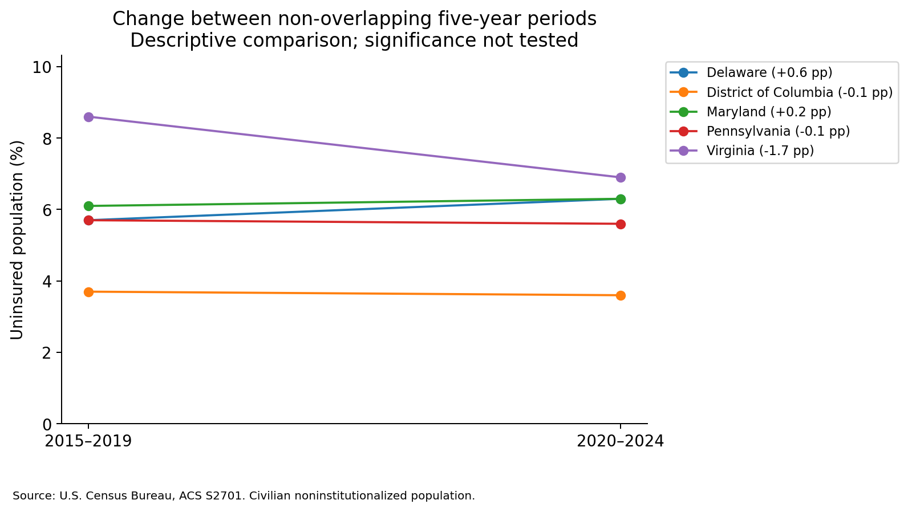

# Slope Diagram

**Also known as:** slope chart, slopegraph

## Purpose and Overview

Slope diagrams show levels and changes in values between two comparison points or periods across multiple categorical groups. They represent a simplified form of a line chart and are useful when the analytical objective is to emphasize differences between two endpoints rather than variation across a longer time series.

A slope diagram consists of two aligned quantitative positions representing the comparison points or periods. The value for each categorical group is plotted at both positions, and a line connects the two values.

The direction of the connecting line communicates the direction of change. An upward slope indicates an increase, a downward slope indicates a decrease, and a relatively flat line indicates little absolute change.

Slope diagrams can also reveal changes in relative position or rank across categories. However, they show only the selected endpoints and do not reveal what occurred between them.

Authors should determine whether **absolute change** or **relative change** is the appropriate analytical focus. Slope diagrams emphasize absolute differences between endpoints and may not be appropriate when percentage or relative change is the primary analytical objective.

## When to Use

Use a slope diagram when the primary analytical objective is to compare levels and changes across exactly two comparable points or periods for multiple categorical groups.

Slope diagrams are particularly useful when readers need to identify:

- which categories increased or decreased;
- differences in starting and ending values;
- differences in the magnitude of change;
- changes in relative position or rank; and
- categories that experienced little or no change.

A slope diagram may also be appropriate when only two comparable observations are available or when the start and end points of a longer series are sufficient for the intended analytical message.

Use a **line chart** when trends across three or more points are important or when variation between the selected endpoints could materially affect interpretation.

Use a **bar chart** when the primary objective is to compare categories within a single period.

Use a **dot plot** when values need to be compared without emphasizing change between two endpoints.

Use a **table** when readers primarily need exact values.

## Data Requirements and Statistical Considerations

A slope diagram requires:

- exactly two comparison points or periods;
- a categorical grouping variable;
- one comparable quantitative measure for each category at both endpoints; and
- consistent definitions, units, universes, and geographic scope across the comparison.

The reproducible Census example on this page uses two **non-overlapping ACS five-year periods**:

- **2015–2019 ACS 5-Year Estimates**
- **2020–2024 ACS 5-Year Estimates**

The example uses U.S. Census Bureau American Community Survey Subject Table S2701, *Selected Characteristics of Health Insurance Coverage in the United States*.

The analytical measure is the percentage of the civilian noninstitutionalized population without health insurance coverage. The example compares Delaware, the District of Columbia, Maryland, Pennsylvania, and Virginia.

It is important to describe the comparison as **2015–2019 versus 2020–2024**, rather than simply “2019 versus 2024.” ACS five-year estimates summarize data collected throughout their respective five-year periods.

Using non-overlapping periods avoids directly comparing two ACS five-year estimates that share years of underlying survey data. This improves the interpretability of the endpoint comparison, although the visualization remains descriptive.

ACS estimates have sampling uncertainty. Census-published margins of error are available in the underlying S2701 data. The slope diagram on this page intentionally focuses on descriptive percentage-point change and does not visually encode the margins of error.

The absence of error bars or significance indicators does not mean the observed changes are statistically significant. Statistical significance requires appropriate analysis using the relevant estimates and uncertainty measures.

The two periods should also be checked for comparability in variable definitions, universe, geographic boundaries, units, and measurement methods before drawing conclusions.

Missing, suppressed, invalid, or unavailable Census values should not be converted to zero.

### Example Data Specification

| Element | Specification |
|---|---|
| Census product | American Community Survey (ACS) 5-Year Estimates |
| Table | S2701 – Selected Characteristics of Health Insurance Coverage in the United States |
| Earlier period | 2015–2019 ACS 5-Year Estimates |
| Later period | 2020–2024 ACS 5-Year Estimates |
| Period relationship | Non-overlapping five-year periods |
| Universe | Civilian noninstitutionalized population |
| Measure | Population without health insurance coverage (%) |
| Geography | Delaware, District of Columbia, Maryland, Pennsylvania, and Virginia |
| Unit | Percent |
| Change measure | Percentage-point difference |
| Uncertainty | Census-published margins of error available in source data; not visually encoded in this example |

## Guidance

In addition to the guidance below, follow the repository's related guidance for axes, color, grids, sources, titles, typography, accessibility, and comparing data and values where applicable.

### Essential

- Clearly identify both comparison points or periods.
- Directly label lines or endpoints in static slope diagrams.
- Ensure each line connects values for the same categorical group.
- Use consistent units, universes, definitions, and geographic scope across both comparison periods.
- Use the same quantitative scale for both endpoints.
- Use consistent scales when multiple slope diagrams or small multiples are intended to be compared.
- Verify that the selected periods are analytically comparable.
- Clearly identify whether reported change is expressed in percentage points, percentages, or another unit.
- Preserve missing, suppressed, invalid, or unavailable values rather than converting them to zero.
- Consider Census-published statistical uncertainty before interpreting observed changes.

### Avoid

- Do not use a slope diagram when trends across three or more points are central to the analytical question.
- Do not reduce a longer time series to two endpoints when important intermediate variation would materially change the interpretation.
- Avoid using slope diagrams when relative change is the primary analytical objective unless the relative-change measure is explicitly designed and explained.
- Avoid displaying so many lines that categories become difficult to identify.
- Avoid inconsistent scales across comparable slope diagrams.
- Do not imply statistical significance from the direction or steepness of a slope alone.
- Do not describe ACS five-year periods as if they were individual annual observations.
- Do not rely only on color to distinguish categories.

## Additional Recommendations

### Recommended

- Limit the number of lines in a static slope diagram so labels and relationships remain interpretable.
- Directly label endpoints or lines to reduce dependence on a legend.
- Maintain adequate spacing between labels and connecting lines.
- Use visual emphasis selectively when a particular category or change is central to the analytical message.
- Report endpoint values when doing so improves interpretation.
- Report the magnitude of change in the correct unit, such as percentage points.
- When statistical testing has been performed, use appropriate indicators to communicate statistically supported differences.
- Provide an accessible table or downloadable data alternative containing both endpoint values.
- Document the data source, table, periods, universe, geography, measure, and units.

### Not Recommended

- Avoid decorative elements that compete with connecting lines or labels.
- Avoid excessive line crossings that make individual categories difficult to follow.
- Avoid implying causation from an observed endpoint change.
- Avoid interpreting small changes as meaningful without considering statistical uncertainty.
- Avoid using different scales across comparable panels.

## Choosing Between Alternatives

| Analytical Goal | Alternative Visualization | Why It May Be Preferable |
|---|---|---|
| Compare change between exactly two comparable periods | Slope Diagram | Emphasizes direction, magnitude, and relative position across categories. |
| Show trends across three or more periods | Line Chart | Shows intermediate variation and the progression of change. |
| Compare category values within one period | Bar Chart | Provides a common baseline for straightforward magnitude comparison. |
| Compare category values without emphasizing change | Dot Plot | Emphasizes quantitative position without connecting endpoints. |
| Present exact values | Table | Allows readers to retrieve and compare precise values directly. |

## Examples and Discussion

### Analytical Question

How did the percentage of the civilian noninstitutionalized population without health insurance coverage change across Delaware, the District of Columbia, Maryland, Pennsylvania, and Virginia between the **2015–2019** and **2020–2024 ACS five-year periods**?

A slope diagram is appropriate because the analytical objective is to compare the same quantitative measure across exactly two non-overlapping periods for a small number of geographic categories.

Each line connects a jurisdiction's uninsured percentage in the 2015–2019 period to its uninsured percentage in the 2020–2024 period.

### Example Results

| Geography | 2015–2019 uninsured | 2020–2024 uninsured | Change |
|---|---:|---:|---:|
| Delaware | 5.7% | 6.3% | +0.6 pp |
| District of Columbia | 3.7% | 3.6% | −0.1 pp |
| Maryland | 6.1% | 6.3% | +0.2 pp |
| Pennsylvania | 5.7% | 5.6% | −0.1 pp |
| Virginia | 8.6% | 6.9% | −1.7 pp |

**Source:** U.S. Census Bureau, American Community Survey, 2015–2019 and 2020–2024 ACS 5-Year Estimates, Subject Table S2701, *Selected Characteristics of Health Insurance Coverage in the United States*.

Virginia shows the largest absolute displayed change, decreasing from 8.6% in 2015–2019 to 6.9% in 2020–2024, a decrease of 1.7 percentage points.

Delaware increases from 5.7% to 6.3%, a change of 0.6 percentage points, while Maryland increases from 6.1% to 6.3%, a change of 0.2 percentage points.

The District of Columbia and Pennsylvania each show a displayed decrease of 0.1 percentage points.

These changes are **descriptive**. The visualization does not establish that the observed changes are statistically significant and does not provide causal explanations for why the estimates changed.

### Example Visualization

The validated reproducible Python implementation generates the primary documented visualization:



**Text description:** The slope diagram compares uninsured population percentages for five jurisdictions between two non-overlapping ACS five-year periods. Virginia decreases from 8.6% in 2015–2019 to 6.9% in 2020–2024, the largest displayed absolute change at −1.7 percentage points. Delaware increases by 0.6 percentage points, Maryland increases by 0.2 percentage points, and the District of Columbia and Pennsylvania each decrease by 0.1 percentage points. The changes are descriptive and should not be interpreted as statistically significant without appropriate statistical analysis.

## Developer Implementation

The reproducible Slope Diagram example uses versioned ACS S2701 source-data snapshots for two non-overlapping five-year periods to compare uninsured population percentages across five selected jurisdictions.

Implementations are provided in both Python and R. Both versions use the same Census table, geographic scope, quantitative measure, period definitions, percentage-point change calculation, and analytical specifications.

The Python-generated image is used as the primary documented visualization. The corresponding R output supports cross-language reproducibility and validation.

### Data Preparation

The example uses two versioned source-data snapshots:

- [`ACSST5Y2019.S2701-Data.csv`](data/ACSST5Y2019.S2701-Data.csv), representing the **2015–2019 ACS 5-Year Estimates**
- [`ACSST5Y2024.S2701-Data.csv`](data/ACSST5Y2024.S2701-Data.csv), representing the **2020–2024 ACS 5-Year Estimates**

The analytical specifications are:

- **Geographic identifier:** State-level `GEO_ID` records for Delaware, District of Columbia, Maryland, Pennsylvania, and Virginia.
- **Estimate:** `S2701_C05_001E`, percentage of the civilian noninstitutionalized population without health insurance coverage.
- **Earlier period:** 2015–2019.
- **Later period:** 2020–2024.
- **Universe:** Civilian noninstitutionalized population.
- **Unit:** Percent.
- **Change:** Later-period percentage minus earlier-period percentage, expressed in percentage points.

The implementations validate the required Census fields and expected jurisdictions in both source files before creating the visualization.

Estimate fields are converted to numeric values and validated before use. Records are matched by geography so that each connecting line links the same jurisdiction across both periods.

Missing, suppressed, invalid, or unavailable Census values should remain missing and should not be converted to zero.

### Implementation Details

| Element | Specification |
|---|---|
| Languages | Python and R |
| Python libraries | pandas and matplotlib |
| R graphics | Base R graphics |
| Data source | U.S. Census Bureau ACS 5-Year Estimates, Subject Table S2701 |
| Earlier source | `ACSST5Y2019.S2701-Data.csv` |
| Later source | `ACSST5Y2024.S2701-Data.csv` |
| Comparison periods | 2015–2019 and 2020–2024 |
| Period relationship | Non-overlapping |
| Measure | Percentage without health insurance coverage |
| Change calculation | Later estimate − earlier estimate |
| Change unit | Percentage points |
| Uncertainty | Census-published MOEs available in source data; not visually encoded |
| Python source file | [`SlopeDiagram.py`](code/SlopeDiagram.py) |
| R source file | [`SlopeDiagram.R`](code/SlopeDiagram.R) |
| Primary visualization output | [`SlopeDiagram1.png`](assets/SlopeDiagram1.png) |
| R validation output | [`SlopeDiagram1_R.png`](assets/SlopeDiagram1_R.png) |

### Python Implementation

The Python implementation uses `pandas` for data preparation and `matplotlib` for visualization.

**Reproducible Python code:** [View `SlopeDiagram.py`](code/SlopeDiagram.py)

The Python implementation:

- reads the versioned 2019 and 2024 ACS S2701 source files;
- interprets those files as the 2015–2019 and 2020–2024 ACS five-year periods;
- validates required Census fields and selected jurisdictions in both snapshots;
- uses `S2701_C05_001E` for the uninsured population percentage;
- converts the estimate fields to numeric values;
- matches each jurisdiction across the two periods;
- calculates percentage-point change as the later-period estimate minus the earlier-period estimate;
- connects each jurisdiction's two estimates with a line;
- directly labels or otherwise clearly identifies the jurisdictions and endpoint values;
- does not visually encode the Census-published margins of error; and
- generates `assets/SlopeDiagram1.png`.

Run the Python implementation from the repository root with:

```bash id="yikfdv"
python visualization_type/code/SlopeDiagram.py
```

### R Implementation

The R implementation reproduces the same Census data selection, two-period comparison, geographic matching, percentage-point calculation, and analytical specifications used by the Python implementation.

**Reproducible R code:** [View `SlopeDiagram.R`](code/SlopeDiagram.R)

The R implementation reads the same two versioned ACS S2701 source snapshots and generates a corresponding visualization using the same analytical logic.

Run the R implementation from the repository root with:

```bash id="z7bf7d"
Rscript visualization_type/code/SlopeDiagram.R
```

Minor differences in typography, spacing, label placement, or other graphical rendering details may occur because Python and R use different graphics systems. These differences do not change the underlying Census data, percentage-point calculations, or analytical interpretation.

### Output Files

| File | Purpose |
|---|---|
| `assets/SlopeDiagram1.png` | Python-generated primary documented slope diagram |
| `assets/SlopeDiagram1_R.png` | R-generated corresponding output used for cross-language validation |
| `data/ACSST5Y2019.S2701-Data.csv` | Versioned ACS S2701 snapshot for the 2015–2019 period |
| `data/ACSST5Y2024.S2701-Data.csv` | Versioned ACS S2701 snapshot for the 2020–2024 period |

Both Python and R implementations were executed using the same versioned ACS S2701 source snapshots.

Cross-language validation confirmed consistent Census estimates, geographic matching, period definitions, percentage-point calculations, and analytical interpretation.

Repository-integration testing also confirmed that both implementations can read the two versioned source files and generate their expected outputs from the Phase 2 sponsor-repository structure.

> **Statistical note:** The displayed changes are descriptive percentage-point differences between two non-overlapping ACS five-year periods. The chart does not establish statistical significance or causality.

## Reproducibility and Adaptation

The example can be adapted to other Census measures, geographies, and comparison periods. When adapting the example:

- **Use exactly two comparable points or periods.** If intermediate trends are important, use a line chart instead.
- **Verify period definitions.** Clearly identify the complete ACS reference periods rather than referring only to their endpoint years.
- **Check period overlap.** Determine whether ACS multi-year estimates share underlying years and document this when relevant.
- **Verify Census variable definitions.** Confirm that the same measure is being compared across both periods.
- **Verify comparability.** Check the universe, geography, units, variable definitions, and measurement methods across both source files.
- **Calculate change correctly.** Distinguish percentage-point change from percent change.
- **Consider uncertainty explicitly.** Review Census-published margins of error before interpreting observed changes.
- **Handle missing values explicitly.** Missing, suppressed, invalid, or unavailable values should not be converted to zero.
- **Check accessibility and legibility.** Verify direct labels, line visibility, typography, contrast, text descriptions, and accessible data alternatives.
- **Document adaptations.** Record changes to the dataset, table, geography, measure, periods, or visualization specification.
- **Revalidate both implementations.** Rerun the Python and R versions after changing source data or analytical logic.

### Maintenance Notes

When maintaining this example:

- preserve the Census table, universe, measure, geographic scope, and comparison-period definitions unless the documentation is intentionally revised;
- verify ACS variable definitions before substituting newer source-data snapshots;
- confirm that the two periods remain analytically comparable;
- clearly distinguish ACS five-year periods from individual annual observations;
- calculate percentage-point change consistently;
- review Census-published uncertainty before interpreting changes;
- do not convert missing, suppressed, invalid, or unavailable Census values to zero;
- rerun both Python and R implementations after source-data or code changes;
- confirm that generated outputs reflect the intended periods and analytical specifications; and
- verify that documentation links, source notes, text descriptions, and accessibility information remain current.

### Validation Before Publication

Before publishing this example or an adapted version:

- verify both Census source files and ACS variable definitions;
- confirm that expected geographic records are present and unique in both periods;
- confirm that the same jurisdictions are matched across both datasets;
- check for missing, invalid, suppressed, or duplicate records;
- verify that the two comparison periods are clearly identified;
- check whether multi-year periods overlap and document the relationship appropriately;
- verify that the same universe, measure, units, and geographic definitions apply across both periods;
- verify percentage-point change calculations;
- review Census-published margins of error before interpreting changes;
- confirm that labels and lines correctly associate each jurisdiction with both endpoint values;
- ensure that the visualization does not imply unobserved intermediate trends;
- confirm that source information and period wording are accurate;
- inspect the generated visualization at the intended display size;
- confirm that a meaningful text description or accessible data alternative is available; and
- rerun both Python and R implementations to confirm reproducibility after substantive changes.

The goal is to preserve the analytical meaning of the Census data while allowing developers to adapt the example to other appropriate measures, geographies, and comparison periods.

## Common Errors and Misinterpretations

| Issue | Why It Matters | Recommended Correction |
|---|---|---|
| Using more than two points | Changes the analytical purpose and can make the display difficult to follow. | Use a line chart when trends across three or more points are important. |
| Calling ACS five-year periods “2019” and “2024” | Can incorrectly imply that the estimates represent individual years. | Identify the full periods as 2015–2019 and 2020–2024. |
| Comparing overlapping multi-year periods without explanation | Shared survey years can complicate interpretation of change. | Check period overlap and document the relationship between periods. |
| Focusing on relative change | Slope diagrams emphasize absolute endpoint differences. | Use an alternative presentation when relative change is the primary objective. |
| Confusing percentage points with percent change | Produces an incorrect interpretation of the magnitude of change. | Clearly identify changes as percentage points when subtracting percentages. |
| Inconsistent definitions or universes | Connected values may not represent comparable measures. | Verify definitions, universe, units, and geography across both periods. |
| Excessive lines | Creates overlapping lines and labels that are difficult to interpret. | Limit the number of categories or consider an interactive alternative. |
| Missing direct labels | Makes individual lines difficult to identify. | Directly label lines or endpoints in static slope diagrams. |
| Ignoring statistical uncertainty | Apparent changes may not be statistically meaningful. | Review Census-published margins of error and use appropriate statistical testing when needed. |
| Masking intermediate trends | Two endpoints do not reveal what occurred between them. | Use a line chart when intermediate trends are analytically important. |
| Inferring causation | Endpoint differences do not establish why a change occurred. | Describe observed changes as descriptive unless supported by appropriate analysis. |
| Reliance on color alone | Can create accessibility problems. | Use direct labels and additional visual cues. |

## Publication Quality Checklist

- [ ] A slope diagram is appropriate for comparing exactly two selected points or periods.
- [ ] Both comparison periods are clearly identified using their complete reference periods.
- [ ] ACS multi-year estimates are not described as individual annual observations.
- [ ] Period overlap has been checked and documented where relevant.
- [ ] The values, units, universes, and definitions are comparable across both periods.
- [ ] The same categories or geographies are correctly matched across both datasets.
- [ ] All lines or endpoints in the static slope diagram are clearly identified.
- [ ] The number of lines remains interpretable.
- [ ] Labels and lines do not overlap excessively.
- [ ] Comparable panels or small multiples use consistent scales.
- [ ] Absolute versus relative change has been considered.
- [ ] Percentage-point change is distinguished from percent change.
- [ ] Intermediate trends are not implied by the connecting lines.
- [ ] Census-published uncertainty has been considered.
- [ ] Statistical significance is not inferred from slope direction or steepness alone.
- [ ] Color is not the only means of identifying categories.
- [ ] Missing, suppressed, or unavailable values are handled appropriately.
- [ ] A meaningful text description or accessible data alternative accompanies the example.
- [ ] Both versioned source-data snapshots are documented.
- [ ] Python and R implementations have been executed and verified.
- [ ] Cross-language results have been reviewed for analytical consistency.
- [ ] Generated output has been inspected before publication.
- [ ] Reproducibility and adaptation instructions are current.
- [ ] Related component guidance has been reviewed.

## Related Pages

- [Bar Chart](barchart.html): use when comparing category values within a single period.
- [Dot Plot Chart](dotplotchart.html): use for category comparisons without emphasizing change between two endpoints.
- [Tables](table.html): use when exact numerical values are the primary requirement.
- [Axes](axes.html): guidance for scales, labels, and axis presentation.
- [Comparing Data and Values](comparison.html): guidance for designing accurate comparisons.
- [Typography](typography.html): guidance for readable labels and text.
- [508 Compliance](508.html): general accessibility requirements.
- [Color](color.html): guidance for appropriate and accessible use of color.
