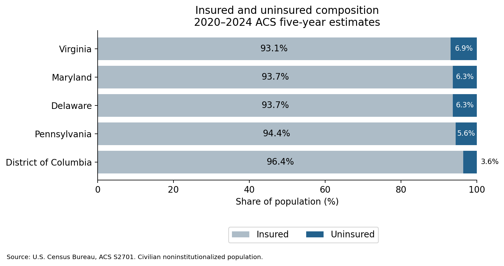

# Stacked Bar Chart

**Also known as:** stacked bar graph

## Purpose and Overview

A stacked bar chart displays categorical data using rectangular bars divided into segments representing subgroups within each main category.

In a standard stacked bar chart, the total length of each bar represents the total value of the main category, while each segment represents the value contributed by a subgroup.

A **100% stacked bar chart** standardizes every bar to the same total length. Each segment then represents its subgroup's proportional contribution to the whole. This design is useful when relative composition is more important than differences in total magnitude.

Stacked bar charts are most effective when the number of subgroups is limited and the analytical objective emphasizes composition. Because only the segment closest to the baseline shares a common starting position across categories, precise comparison of other subgroup values can be difficult.

## When to Use

Use a stacked bar chart when the analytical objective is to compare categories while also showing how subgroups contribute to each category.

Use a **100% stacked bar chart** when:

- each category represents a meaningful whole;
- the subgroup components are mutually interpretable parts of that whole;
- proportional composition is more important than total magnitude; and
- the number of subgroups remains small enough for clear interpretation.

If one subgroup is the primary analytical focus, consider placing that subgroup closest to the baseline so differences across categories are easier to compare.

A **regular bar chart** or grouped bar chart may be preferable when accurate comparison of individual subgroup values is more important than part-to-whole composition.

A **table** may be preferable when readers primarily need exact numerical values for multiple categories and subgroups.

Consider another visualization or coordinated views when the number of subgroups makes the stacked display difficult to interpret.

## Data Requirements and Statistical Considerations

A stacked bar chart requires a categorical variable and two or more subgroup measures associated with each category.

For a standard stacked bar chart, subgroup values contribute to a category total. For a 100% stacked bar chart, subgroup values should represent components of a meaningful whole and should sum, or approximately sum because of rounding, to 100%.

The reproducible Census example on this page uses the U.S. Census Bureau American Community Survey (ACS) 2020–2024 5-Year Estimates, Subject Table S2701, *Selected Characteristics of Health Insurance Coverage in the United States*.

The universe is the civilian noninstitutionalized population. The example compares the percentage **with health insurance coverage** and the percentage **without health insurance coverage** across Delaware, the District of Columbia, Maryland, Pennsylvania, and Virginia.

These two measures represent complementary components of the health-insurance-coverage composition and sum to approximately 100% for each jurisdiction.

ACS five-year estimates represent data collected across the full five-year period and should not be interpreted as estimates for only the final year.

ACS estimates also have sampling uncertainty. Census-published margins of error are available in the underlying S2701 data. This stacked bar example intentionally does **not** display error bars because its primary analytical purpose is to demonstrate part-to-whole composition.

The absence of displayed error bars does not mean that the underlying survey estimates have no uncertainty. Published margins of error and applicable Census statistical guidance should be considered before making statistical claims about differences between jurisdictions.

Missing, suppressed, invalid, or unavailable Census values should not be converted to zero. Developers should also verify the universe, denominator, geographic scope, units, reference period, annotations, and subgroup definitions before creating a stacked composition.

### Example Data Specification

| Element | Specification |
|---|---|
| Chart type | 100% stacked bar chart |
| Census product | American Community Survey (ACS) 5-Year Estimates |
| Table | S2701 – Selected Characteristics of Health Insurance Coverage in the United States |
| Reference period | 2020–2024 |
| Universe | Civilian noninstitutionalized population |
| Components | With health insurance coverage; without health insurance coverage |
| Geography | Delaware, District of Columbia, Maryland, Pennsylvania, and Virginia |
| Unit | Percent |
| Composition | Components sum to approximately 100% |
| Uncertainty | Census-published margins of error available in source data; not visually encoded in this example |

## Guidance

In addition to the guidance below, follow the repository's related guidance for axes, color, grids, legends, sources, titles, typography, accessibility, and comparing data and values where applicable.

### Essential

- Start stacked bars at zero because bar and segment lengths communicate magnitude.
- Clearly identify the categories, subgroup components, measure, and units.
- Ensure that subgroup definitions are mutually interpretable within the intended composition.
- For a 100% stacked bar chart, verify that subgroup components sum, or approximately sum because of rounding, to 100%.
- Maintain the same subgroup order across all bars.
- Use a legend or direct labels so readers can identify each subgroup.
- If one subgroup is the analytical focus, consider placing it closest to the baseline.
- Preserve natural category order when categories are ordinal.
- Maintain appropriate spacing between bars.
- Preserve missing, suppressed, invalid, or unavailable values rather than converting them to zero.
- When displaying ACS estimates, consider Census-published statistical uncertainty even when uncertainty is not visually encoded.

### Avoid

- Do not truncate the baseline.
- Do not change subgroup order from one category to another.
- Avoid excessive numbers of subgroups that make segments difficult to identify and compare.
- Do not use a stacked bar chart when precise comparison of several subgroup values is the primary analytical objective.
- Do not imply that visually similar segment sizes establish statistical equivalence.
- Do not interpret small differences between ACS estimates as statistically significant without appropriate analysis.
- Do not describe an ACS five-year estimate as representing only the final year of the five-year period.
- Do not use color as the only means of identifying subgroup meaning.

## Additional Recommendations

### Recommended

- Use analytical reasoning to determine subgroup ordering.
- Place a subgroup of primary interest closest to the baseline when doing so supports comparison.
- Use a qualitative color scheme when subgroups do not have an inherent order.
- Use a sequential color scheme when subgroups have a meaningful order and the encoding supports interpretation.
- Keep subgroup ordering consistent across categories.
- Use direct labels when they improve interpretation and reduce dependence on a legend.
- Limit the number of subgroups to preserve readability.
- Use accessible contrast and ensure subgroup distinctions remain understandable without relying solely on color.
- Provide a meaningful text description or accessible data alternative.
- Document the source, table, reference period, universe, geography, component definitions, and units.

### Not Recommended

- Avoid ordering subgroups alphabetically by default unless alphabetical order serves the analytical purpose.
- Avoid excessive decorative elements that compete with the composition.
- Avoid using more subgroups than readers can reasonably distinguish.
- Avoid inconsistent color or subgroup encoding across comparable charts.
- Avoid treating rounded percentages as mathematically exact when small rounding differences occur.

## Choosing Between Alternatives

| Analytical Goal | Alternative Visualization | Why It May Be Preferable |
|---|---|---|
| Compare individual category values | Bar Chart | Provides a common baseline for precise magnitude comparison. |
| Compare individual subgroup values across categories | Grouped Bar Chart | Places comparable values on a common baseline instead of stacking them. |
| Compare proportional composition across categories | 100% Stacked Bar Chart | Standardizes each category to 100%, emphasizing relative composition. |
| Present exact category and subgroup values | Table | Allows readers to inspect precise numerical values directly. |

## Examples and Discussion

### Analytical Question

How does health insurance coverage composition compare across Delaware, the District of Columbia, Maryland, Pennsylvania, and Virginia?

A 100% stacked bar chart is appropriate because the two displayed measures—population with health insurance coverage and population without health insurance coverage—represent complementary parts of the same population composition.

Each jurisdiction is represented by one bar totaling approximately 100%. The two segments show the proportion with and without health insurance coverage.

### Example Results

| Geography | With health insurance coverage | Without health insurance coverage |
|---|---:|---:|
| Virginia | 93.1% | 6.9% |
| Maryland | 93.7% | 6.3% |
| Delaware | 93.7% | 6.3% |
| Pennsylvania | 94.4% | 5.6% |
| District of Columbia | 96.4% | 3.6% |

**Source:** U.S. Census Bureau, American Community Survey, 2020–2024 ACS 5-Year Estimates, Subject Table S2701, *Selected Characteristics of Health Insurance Coverage in the United States*.

For each jurisdiction, the insured and uninsured percentages sum to approximately 100%, confirming the intended part-to-whole composition.

The District of Columbia has the largest displayed insured share at 96.4% and the smallest displayed uninsured share at 3.6%. Virginia has the smallest displayed insured share at 93.1% and the largest displayed uninsured share at 6.9%.

Maryland and Delaware both display 93.7% insured and 6.3% uninsured after rounding.

The chart is intended to communicate composition rather than establish statistically significant differences among jurisdictions. Census-published margins of error are available in the source data but are not visually encoded in this example.

The 2020–2024 ACS five-year estimates represent the full five-year period and should not be interpreted as measurements for 2024 alone.

### Example Visualization

The validated reproducible Python implementation generates the primary documented visualization:



**Text description:** The 100% stacked bar chart compares health insurance coverage composition across five jurisdictions. Virginia displays 93.1% insured and 6.9% uninsured; Maryland and Delaware each display 93.7% insured and 6.3% uninsured; Pennsylvania displays 94.4% insured and 5.6% uninsured; and the District of Columbia displays 96.4% insured and 3.6% uninsured. Each bar totals approximately 100%. Census-published margins of error are available in the source data but are not visually encoded in this example.

## Developer Implementation

The reproducible Stacked Bar Chart example uses a versioned ACS S2701 source-data snapshot to create a 100% stacked bar chart comparing health insurance coverage composition across five selected jurisdictions.

Implementations are provided in both Python and R. Both versions use the same Census source data, geographic scope, insured and uninsured measures, subgroup ordering, and analytical specifications.

The Python-generated image is used as the primary documented visualization on this page. The corresponding R output supports cross-language reproducibility and validation.

### Data Preparation

The example uses the following ACS S2701 fields and analytical specifications:

- **Geographic identifier:** State-level `GEO_ID` records for Delaware, District of Columbia, Maryland, Pennsylvania, and Virginia.
- **Insured estimate:** `S2701_C03_001E`, percentage of the civilian noninstitutionalized population with health insurance coverage.
- **Uninsured estimate:** `S2701_C05_001E`, percentage of the civilian noninstitutionalized population without health insurance coverage.
- **Reference period:** 2020–2024 ACS 5-Year Estimates.
- **Universe:** Civilian noninstitutionalized population.
- **Unit:** Percent.
- **Geographic scope:** Five selected jurisdictions.

The implementations validate the required Census fields and expected jurisdictions before creating the visualization.

Estimate fields are converted to numeric values and validated before use. The implementations also verify that the insured and uninsured percentages sum to approximately 100% for each jurisdiction.

Missing, suppressed, invalid, or unavailable Census values should remain missing and should not be converted to zero.

### Implementation Details

| Element | Specification |
|---|---|
| Chart type | 100% stacked bar chart |
| Languages | Python and R |
| Python libraries | pandas and matplotlib |
| R graphics | Base R graphics |
| Data source | U.S. Census Bureau, 2020–2024 ACS 5-Year Estimates, Subject Table S2701 |
| Geographic level | Selected state-level jurisdictions |
| Components | Insured percentage and uninsured percentage |
| Composition validation | Components sum to approximately 100% |
| Uncertainty | Census-published MOEs available in source data; not visually encoded |
| Python source file | [`StackedBarChart.py`](code/StackedBarChart.py) |
| R source file | [`StackedBarChart.R`](code/StackedBarChart.R) |
| Versioned source data | [`ACSST5Y2024.S2701-Data.csv`](data/ACSST5Y2024.S2701-Data.csv) |
| Primary visualization output | [`StackedBarChart1.png`](assets/StackedBarChart1.png) |
| R validation output | [`StackedBarChart1_R.png`](assets/StackedBarChart1_R.png) |

### Python Implementation

The Python implementation uses `pandas` for data preparation and `matplotlib` for visualization.

**Reproducible Python code:** [View `StackedBarChart.py`](code/StackedBarChart.py)

The Python implementation:

- reads the versioned ACS S2701 source file from `visualization_type/data/`;
- validates the required Census fields and selected jurisdictions;
- uses `S2701_C03_001E` for the insured percentage;
- uses `S2701_C05_001E` for the uninsured percentage;
- converts the estimate fields to numeric values;
- validates that the two components sum to approximately 100%;
- maintains consistent subgroup ordering across jurisdictions;
- represents each jurisdiction as a 100% composition;
- uses consistent subgroup encoding;
- does not visually encode the Census-published margins of error; and
- generates `assets/StackedBarChart1.png`.

Run the Python implementation from the repository root with:

```bash
python visualization_type/code/StackedBarChart.py
```

### R Implementation

The R implementation reproduces the same Census data selection, insured and uninsured measures, geographic scope, subgroup ordering, 100% composition logic, and uncertainty treatment used by the Python implementation.

**Reproducible R code:** [View `StackedBarChart.R`](code/StackedBarChart.R)

The R implementation reads the same versioned ACS S2701 source snapshot and generates a corresponding visualization using the same analytical specifications.

Run the R implementation from the repository root with:

```bash
Rscript visualization_type/code/StackedBarChart.R
```

Minor differences in typography, spacing, label placement, or other graphical rendering details may occur because Python and R use different graphics systems. These differences do not change the underlying Census data, calculations, or analytical interpretation.

### Output Files

| File | Purpose |
|---|---|
| `assets/StackedBarChart1.png` | Python-generated primary documented 100% stacked bar chart |
| `assets/StackedBarChart1_R.png` | R-generated corresponding output used for cross-language validation |
| `data/ACSST5Y2024.S2701-Data.csv` | Versioned ACS S2701 source-data snapshot used by both implementations |

Both Python and R implementations were executed against the same versioned ACS S2701 source data.

Cross-language validation confirmed consistent Census estimates, geographic scope, insured/uninsured composition, subgroup ordering, and analytical interpretation.

Repository-integration testing also confirmed that both implementations can read the versioned source data and generate their expected outputs from the Phase 2 sponsor-repository structure.

> **Statistical note:** This stacked bar chart intentionally emphasizes insured/uninsured composition and does not display the Census-published margins of error. The absence of error bars does not remove the underlying sampling uncertainty.

## Reproducibility and Adaptation

The example can be adapted to other Census measures, geographies, subgroup compositions, and reporting periods. When adapting the example:

- **Verify subgroup definitions.** Confirm that the selected components represent meaningful parts of the intended whole.
- **Validate the composition.** For a 100% stacked bar chart, confirm that components sum, or approximately sum because of rounding, to 100%.
- **Verify Census variable definitions.** Confirm that each selected field represents the intended measure and population.
- **Preserve the reference period.** Clearly identify the complete ACS five-year period rather than describing the estimate as representing only its final year.
- **Preserve the zero baseline.** Bar and segment lengths represent magnitude.
- **Maintain consistent subgroup order.** Use the same segment ordering across all categories.
- **Consider uncertainty explicitly.** Review Census-published margins of error even when uncertainty is not displayed directly.
- **Handle missing values explicitly.** Missing, suppressed, invalid, or unavailable values should not be converted to zero.
- **Preserve population definitions.** Confirm that the universe and denominator remain appropriate when substituting other Census measures.
- **Check accessibility and legibility.** Verify labels, subgroup distinctions, contrast, typography, text descriptions, and accessible data alternatives at the intended display size.
- **Document adaptations.** Record changes to the dataset, table, geography, components, reference period, or visualization specification.
- **Revalidate both implementations.** Rerun the Python and R versions after changing source data or analytical logic.

### Maintenance Notes

When maintaining this example:

- preserve the Census table, universe, component definitions, geography, and reference-period definitions unless the documentation is intentionally revised;
- verify ACS variable definitions before substituting a newer source-data snapshot;
- confirm that the components continue to represent a valid composition;
- preserve the zero baseline and consistent subgroup ordering;
- review Census-published uncertainty even when it is not displayed directly;
- do not convert missing, suppressed, invalid, or unavailable Census values to zero;
- rerun both Python and R implementations after source-data or code changes;
- confirm that generated outputs reflect the intended data and analytical specifications; and
- verify that documentation links, source notes, text descriptions, and accessibility information remain current.

### Validation Before Publication

Before publishing this example or an adapted version:

- verify the Census source file and ACS variable definitions;
- confirm that expected geographic records are present and unique;
- check for missing, invalid, suppressed, or duplicate records;
- verify that subgroup components represent the intended whole;
- confirm that components sum, or approximately sum because of rounding, to 100%;
- verify that bars begin at zero;
- confirm consistent subgroup ordering across categories;
- confirm that labels and subgroup identification are clear;
- review Census-published margins of error before interpreting differences;
- confirm that source information and reference-period wording are accurate;
- inspect the generated visualization at the intended display size;
- confirm that a meaningful text description or accessible data alternative is available; and
- rerun both Python and R implementations to confirm reproducibility after substantive changes.

The goal is to preserve the analytical meaning of the Census data while allowing developers to adapt the example to other appropriate compositions, geographies, measures, and reporting periods.

## Common Errors and Misinterpretations

| Issue | Why It Matters | Recommended Correction |
|---|---|---|
| Too many subgroups | Makes individual segments difficult to distinguish and compare. | Reduce the number of subgroups or consider another visualization. |
| Inconsistent subgroup order | Makes comparisons across categories more difficult. | Maintain the same subgroup order across all bars. |
| Comparing segments without a common baseline | Small differences may be difficult to judge accurately. | Place the subgroup of interest closest to the baseline or use a grouped bar chart. |
| Nonzero baseline | Can visually exaggerate differences in bar or segment lengths. | Start stacked bars at zero. |
| Invalid part-to-whole relationship | A 100% stacked chart can mislead if components do not represent a meaningful whole. | Verify subgroup definitions and validate the composition before plotting. |
| Components do not total approximately 100% | May indicate incompatible measures, data-quality problems, or incorrect denominator selection. | Validate component totals before publication. |
| Missing subgroup without explanation | May cause readers to interpret missing data as zero. | Preserve missing values and explain unavailable or suppressed data. |
| Excessive or inappropriate color | Makes subgroup identification more difficult. | Use an appropriate color scheme and consistent subgroup encoding. |
| Ignoring uncertainty because error bars are absent | ACS estimates still have sampling uncertainty. | Review Census-published margins of error and communicate relevant limitations. |
| Treating a five-year estimate as a single-year value | Misstates the ACS reference period. | Describe 2020–2024 estimates as representing the full five-year period. |

## Publication Quality Checklist

- A stacked bar chart is appropriate for the analytical question.
- A 100% stacked bar chart is used only when components represent a meaningful whole.
- Bars begin at zero.
- Categories and subgroup components are clearly defined.
- Components sum, or approximately sum because of rounding, to 100%.
- Subgroup order is consistent across categories.
- The number of subgroups remains interpretable.
- The subgroup of greatest analytical importance is positioned appropriately.
- A legend or direct labels identify all subgroups.
- Missing, suppressed, or unavailable values are handled appropriately.
- Color is used purposefully and is not the only means of communicating subgroup meaning.
- The Census dataset, table, universe, geography, reference period, components, and units are documented.
- Census-published uncertainty has been considered even when it is not visually encoded.
- Statistical significance is not inferred from the chart alone.
- A meaningful text description or accessible data alternative accompanies the example.
- The versioned source-data snapshot is documented.
- Python and R implementations have been executed and verified.
- Cross-language results have been reviewed for analytical consistency.
- Generated output has been inspected before publication.
- Reproducibility and adaptation instructions are current.
- Related component guidance has been reviewed.

## Related Pages

- [Bar Chart](barchart.html): use when the primary objective is to compare category values without displaying subgroup composition.
- [Dot Plot Chart](dotplotchart.html): use when position along a common scale supports categorical comparison without composition.
- [Tables](table.html): use when exact category and subgroup values are the primary requirement.
- [Axes](axes.html): guidance for axis labels, scales, and tick marks.
- [Comparing Data and Values](comparison.html): guidance for designing accurate comparisons.
- [Typography](typography.html): guidance for readable labels and text.
- [508 Compliance](508.html): general accessibility requirements.
- [Color](color.html): guidance for appropriate and accessible use of color.
